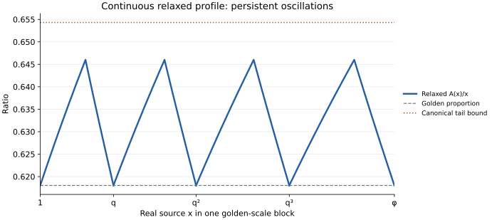

# Martingales, dispersion, and the open limit question

[Project home](../README.md) · [Research map](README.md#technical-research-map)

This note gives a one-sided landing-displacement criterion for convergence,
then gives a finite-window maximum principle, a contact-loss budget and
canonical clock restrictions. It also proves the martingale identities and the conditional route from
four-generation dispersion to an upper decay rate. It develops basin
lower envelopes and scalar-valid policies. Uniform dispersion remains open.
Explicit nonconvergent extensions show why golden bounds, finite prefixes,
and exact collars alone cannot prove the actual limit.
Prerequisites: [global golden structure](golden-proof.md) and the
[profile identity](five-window-closure.md#7-fibonacci-profile-renormalization-and-defect-dynamics).

## Contents

- [A one-sided landing-displacement criterion](#a-one-sided-landing-displacement-criterion)
- [A finite-window maximum principle](#a-finite-window-maximum-principle)
- [A smaller tail bound from cycle enclosures](#a-smaller-tail-bound-from-cycle-enclosures)
- [Concentrated high terminal values force a uniform loss](#concentrated-high-terminal-values-force-a-uniform-loss)
- [Continuous cycle readouts do not determine the golden profile](#continuous-cycle-readouts-do-not-determine-the-golden-profile)
- [An exact budget for the outermost cap contacts](#an-exact-budget-for-the-outermost-cap-contacts)
- [Defect production by the canonical clock](#defect-production-by-the-canonical-clock)
- [Contact residues on longer cycles](#contact-residues-on-longer-cycles)
- [Synchronized negative-jump intervals under sublinear drawdown](#synchronized-negative-jump-intervals-under-sublinear-drawdown)
- [Complementary drawdowns and the upward modulus](#complementary-drawdowns-and-the-upward-modulus)
- [Size-biased martingales and the four-generation dispersion criterion](#size-biased-martingales-and-the-four-generation-dispersion-criterion)
- [A phase-free lower bound from the prescribed basin](#a-phase-free-lower-bound-from-the-prescribed-basin)
- [Quadratic basin dispersion in the unit-defect family](#quadratic-basin-dispersion-in-the-unit-defect-family)
- [Cap-adaptive quadratic dispersion](#cap-adaptive-quadratic-dispersion)
- [A logarithmic horizon from one retained child](#a-logarithmic-horizon-from-one-retained-child)
- [Diophantine dispersion in cube-root Fibonacci neighborhoods](#diophantine-dispersion-in-cube-root-fibonacci-neighborhoods)
- [Additive dispersion policies without orbit qualification](#additive-dispersion-policies-without-orbit-qualification)
- [Two-split moment policies and cycle-average dispersion](#two-split-moment-policies-and-cycle-average-dispersion)
- [Block-terminal means remove intermediate scalar constraints](#block-terminal-means-remove-intermediate-scalar-constraints)
- [Finite prefixes and exact collars do not force convergence](#finite-prefixes-and-exact-collars-do-not-force-convergence)
- [Bounded forcing with the complete prescribed clock](#bounded-forcing-with-the-complete-prescribed-clock)
- [Exact nesting after finitely many forced values](#exact-nesting-after-finitely-many-forced-values)
- [Exact small-cap closure still does not force convergence](#exact-small-cap-closure-still-does-not-force-convergence)

### A one-sided landing-displacement criterion

For the prescribed split g=T_n^C(n-1)(n-1), define

$$
e(n)=T_n(g)-g=n-C(g)-g,\qquad d(n)=C(n)/n-\alpha.
$$

This is the one-step displacement at the selected landing point, not
the deviation C(n)-alpha*n. Put

$$
L=\limsup_{n\to\infty}d(n),\qquad
E_-=\limsup_{n\to\infty}\frac{\max(0,-e(n))}{n}.
$$

**Theorem (extremal phase and one-sided displacement).** For the actual
recurrence, using the established golden structure,

$$
0\le L\le\phi E_-.
$$

Consequently C(n)/n tends to alpha if and only if
`max(0,-e(n))=o(n)`. In that case the entire eventual cycle reached from
n-1, not just its selected step, has diameter o(n).

The proposed route from small displacement through near-extremal children
and Fibonacci phase is due to Benoît Cloitre. The argument below completes
the conditional reduction by minimizing phase among extremal subsequences;
it needs only the negative part of the selected displacement. It does not
prove that this part is sublinear, or give a decay rate for C.

**Proof of the bound.** The exact child identity is

$$
d(n)=\frac gn d(g)+\frac{n-g}{n}d(n-g).
$$

Both child fractions are bounded away from zero for large n: the proved
split restriction is 5/9<g/n<2/3. Thus, along any sequence with d(n)->L,
both d(g) and d(n-g) tend to L. Indeed each is at most L+o(1), and a
fixed positive deficit in either would give a positive deficit at n.

If L=0 there is nothing to prove. Suppose L>0. For F_k<=n<F_(k+1),
write theta(n)=n/F_k. The cluster set of (d(n),theta(n)) as n tends to
infinity is compact, with 1<=theta<=phi at its limits. Among its points
whose first coordinate is L choose one with minimum second coordinate
theta_*. Take a sequence realizing (L,theta_*).

The capture theorem gives F_(k-1)<=g<=F_k. Fibonacci endpoints have
d(g)->0, so neither endpoint can occur infinitely often on this sequence.
Eventually g is strictly inside that block, and its canonical order is
k-1. Pass to a subsequence with g/n->lambda. Since d(g)->L, minimality
of theta_* and F_k/F_(k-1)->phi give

$$
\theta_*\le\lim\frac{g}{F_{k-1}}
  =\lambda\phi\theta_*,\qquad \lambda\ge\alpha.
$$

The selected-step identity now yields

$$
\lim\frac{e(n)}n
 =1-\lambda(1+\alpha+L)
 \le1-\alpha(\phi+L)=-\alpha L.
$$

Therefore E_->=alpha*L, proving L<=phi*E_-. This also proves a useful
contrapositive: a positive limiting excess forces negative jumps of
macroscopic size along an extremal subsequence. No assertion about an
infinite descent crossing a phase boundary is needed.

**Converse and cycle diameter.** For completeness there is also a
quantitative reverse estimate. Let J(n) be the largest absolute step
on any cycle of T_n. All cycle points exceed n/4 by the established
three-quarter bound. Fix epsilon>0, and set
`m=alpha-epsilon`, `r=alpha+L+epsilon`. For large n, all their arguments
satisfy m*x<=C(x)<=r*x. Choose epsilon small enough that 0<m<=r<1.
If u and v are respectively the minimum and maximum over all cycle
points, existence of a cycle predecessor for each point gives

$$
u\ge n-rv,\qquad v\le n-mu.
$$

Hence

$$
u\ge\frac{1-r}{1-mr}n,\qquad
v\le\frac{1-m}{1-mr}n,\qquad
J(n)\le v-u\le\frac{r-m}{1-mr}n.
$$

Letting epsilon decrease to zero proves

$$
\limsup_{n\to\infty}\frac{J(n)}n
 \le\frac{\phi L}{1-L}.
$$

If L=0 this gives J(n)=o(n), and in particular E_-=0. Conversely
E_-=0 gives L=0 by the first bound; the established liminf is alpha,
so the full ratio converges. QED.

**Finite evidence and the remaining lemma.** The
[landing-displacement check](verification/landing_displacement.py) reports
exact dyadic-shell extrema and independently checks sequence values,
selected splits and the sign/indexing of e(n). Its
[recorded output](verification/landing-displacement.json) is finite evidence.
The last complete dyadic shells give the following maxima of
`max(0,-e(n))/n`:

| Shell (lower exclusive, upper inclusive) | Maximum |
|---|---:|
| (1,048,576, 2,097,152] | 0.005655816384 |
| (2,097,152, 4,194,304] | 0.005677227902 |
| (4,194,304, 8,388,608] | 0.005189825549 |
| (8,388,608, 16,777,216] | 0.004939054055 |

In the last shell the exact maximum is 45807/9274448, at n=9274448,
with g=5749282 and T_n(g)=5703475. The positive-jump maximum there is
46178/9274077=0.004979255618. The negative maxima are not monotone.
These computations do not bound E_-: even a decreasing list of finite
maxima cannot establish the required uniform tail estimate. Proving that estimate for
the actual selected orbit remains the convergence problem in this form.
Reproduce with `python3 cloitre-conway/verification/landing_displacement.py`.

### A finite-window maximum principle

**Theorem (Cloitre).** For every j>=8,

$$
\sup_{n\ge F_j}\frac{C(n)}n
=\max_{F_j\le n<F_{j+2}}\frac{C(n)}n.
$$

**Proof.** For n>=F_(j+2), the closed-block child bounds in the
[capture theorem](golden-proof.md#6-the-upper-cap-fibonacci-identities-and-the-full-equality-set)
give both children at least F_j. Both are strictly smaller than n.
The parent ratio is their weighted average:

$$
\frac{C(n)}n=\frac gn\frac{C(g)}g
+\frac{n-g}{n}\frac{C(n-g)}{n-g}.
$$

Strong induction extends the maximum on the stated finite window to
every later n. The reverse inequality is immediate. QED.

An independent evaluation of every n in
[F_40,F_42)=[102334155,267914296) gives

$$
\max_{F_{40}\le n<F_{42}}\frac{C(n)}n
=\frac{84170200}{128407654}
=\frac{42085100}{64203827}<0.65549208.
$$

Equality holds at n=128407654. Thus the same exact upper bound holds
for **every n>=F_40**. This confirms Cloitre's finite certificate using
an independently implemented Brent evaluator, without reading his array.
The 165580141 integer comparisons, the maximum, and literal checks of
both values and selected splits through 4096 are recorded in
[compact evidence](verification/canonical-erosion.json).
This is a computer-assisted infinite-tail bound, not a convergence proof.

### A smaller tail bound from cycle enclosures

The preceding certificate supplies M=42085100/64203827 on the whole
tail from F_40. Cycle enclosures improve it using only a shorter, already
verified canonical prefix. The later sources are bounded by intervals;
their canonical values and prescribed clocks are not computed.

**Theorem (computer-assisted tail bound).** For every n>=F_41=165580141,

$$
\frac{C(n)}n\le
K:=\frac{19580084505646265}{29872542956223744}
<0.65545423.
$$

The improvement over M is approximately 0.0000378529. It does not
establish convergence to alpha.

**The interval certificate.** Partition the indices into consecutive
cells of width 512. The retained canonical prefix supplies exact minimum
and maximum values on each complete cell through 141422079. Two independent
full-clock evaluators had previously agreed at every index through 141422324.
The certificate then bounds C on every remaining source cell through
F_42-1=267914295, using only earlier cell bounds.

For a source interval I=[a,b], the
[cycle-capture theorem](golden-proof.md#6-the-upper-cap-fibonacci-identities-and-the-full-equality-set)
and the strict cycle-point bounds give an initial interval J containing
every periodic point for every source in I. On a natural block, its
endpoints are

$$
\ell(n)=\max(F_{j-1},n-F_{j-1}),\qquad
r(n)=\min(F_j,n-F_{j-2}).
$$

Both are nondecreasing, including across Fibonacci boundaries, so
J=[ell(a),r(b)] can be intersected with the integer bounds
5a/9<x<2b/3. Suppose all relevant periodic points lie in J, and earlier
cell bounds give

$$
c_-\le C(x)\le c_+\qquad(x\in J).
$$

Every periodic point has a periodic predecessor in J. Hence it also
lies in [a-c_+,b-c_-]. Replace J by

$$
J\cap[a-c_+,b-c_-].
$$

Repeating this operation preserves containment of every cycle. The
certificate performs at most 100 rounds; reaching a fixed interval is
unnecessary for correctness. It includes cycles of every period. The
prescribed depth reaches a cycle, so its actual selected point remains
inside every refined interval.

Partition the final J into slices [u,v] lying within individual argument
cells. If the selected point belongs to such a slice, its complement
belongs to [a-v,b-u]. Earlier range bounds for C on these two intervals
therefore bound their sum. Taking the minimum lower bound and maximum
upper bound over all slices bounds C(n) throughout the source cell.
Intersect these bounds with G(a), U(b), and floor(M*b).

Every range query is widened to complete cells. Its returned lower bound
is the minimum of their lower bounds, and its upper bound the maximum of
their upper bounds. Every queried cell is strictly earlier than its
source cell. Induction on cells therefore validates the entire
certificate; none of the new bounds supports itself.

The [C++ checker](verification/cycle_enclosure.cpp) uses a segment tree
for range queries. An [independent checker](verification/cycle_enclosure_check.py)
recomputes the prefix-cell extrema with NumPy and uses sparse tables for
the later queries. It verifies all 247056 derived cells, 24705600 cycle
enclosure queries and 15073001 readout slices. Every lower and upper
endpoint agrees. The [compact evidence](verification/cycle-enclosure.json)
records the result

$$
\frac{C(n)}n\le
R:=\frac{33883719}{51697408}
\quad(F_{41}\le n<F_{42}).
$$

Here each cell's upper value is divided by its smallest source in this
row. The exact anchor C(F_42)=F_41 extends the same bound to n=F_42.
The exporter has independent Brent and visited-orbit modes, both checked
against the retained prefix through 131072 and literal clocks through 4096.
A width 256 refinement gives a slightly stronger row estimate; the
displayed theorem uses only the width 512 certificate.

**Propagation to the infinite tail.** If F_42<=n<F_43, the selected high
child a lies in [F_41,F_42], and the other child b in [F_40,F_41].
Thus C(a)<=R*a, C(b)<=M*b, and a/n>5/9. Since R<M,

$$
\frac{C(n)}n
\le\frac anR+\frac bnM
\le\frac59R+\frac49M=K.
$$

The preceding row already has R<K. Applying the finite-window maximum
principle at j=41 now gives the stated bound for every n>=F_41.
Every interval endpoint and the final bound are checked by integer
arithmetic; the infinite-tail conclusion uses this argument rather than extrapolation
from the bounded range.

**Continuing the enclosure induction.** The proved bound K can now replace
M when a source cell starts at or above F_41. Cells starting below F_41
retain M, including the cell that crosses that threshold. The new cap is
therefore valid throughout every source cell. All other enclosure and
readout operations are unchanged. Continuing from the same exact prefix
through F_46-1 gives the following bounds on complete natural rows:

| Row j: F_j<=n<F_(j+1) | Certified upper bound for C(n)/n |
|---|---|
| 41 | 33883719/51697408 |
| 42 | 37081435/56592896 |
| 43 | 44743721/68364288 |
| 44 | 567008869/866573824 |
| 45 | 930025197/1421405696 |

For each row, a cell that crosses a Fibonacci boundary contributes on
both sides. Its denominator is its smallest source in the row, and all
comparisons use exact integer cross-products. The independent verifier
checks all 3310332 derived cells, 331033200 cycle-enclosure queries and
1752115676 readout slices against strictly earlier cells. This calculation
continues value intervals; no canonical terms beyond the retained prefix
are generated. The existing code and
[evidence](verification/cycle-enclosure.json) contain both passes.

**Theorem (continued computer-assisted tail bound).** For every
n>=F_44=701408733,

$$
\frac{C(n)}n\le
\frac{567008869}{866573824}<0.65431110.
$$

**Proof.** The row-45 bound is smaller than the row-44 bound, by exact
cross-multiplication. Thus the two rows together bound the whole window
[F_44,F_46). The finite-window maximum principle at j=44 extends that
bound to every later n. QED.

This improves the original M by approximately 0.00118098 and K by
approximately 0.00114313. It still leaves a positive gap above alpha;
neither these finite rows nor the infinite-tail implication prove that
continued enclosure passes converge to alpha.

### Concentrated high terminal values force a uniform loss

A finite-window maximum need not propagate without loss. When its near-maximum
values occupy a sufficiently narrow size range, the actual selected recursion
tree must put a uniform fraction of its terminal mass outside that range.

**Theorem (terminal-superlevel loss).** Fix j>=40 and put L=F_j and
U=F_(j+2). Suppose C(x)/x<=M for L<=x<U. Let epsilon>0, and suppose

$$
\{x\in[L,U):C(x)/x>M-\varepsilon\}\subseteq[s,t],
\qquad L\le s\le t<U,\qquad \frac ts<\frac54.
$$

Then, for every integer n>=max(U,ceil(3t)),

$$
\frac{C(n)}n\le M-\varepsilon\frac{L}{3t}.
$$

**Proof.** Expand the actual selected children at every source at least U,
stopping at sources below U. Native capture puts every terminal source in
[L,U); the tree is finite because every child is smaller than its parent.
Terminal sizes sum to n, and their C-values sum to C(n).

Call a terminal good if its ratio exceeds M-epsilon, and bad otherwise.
The strict cycle-point bounds put the larger/smaller child ratio in (5/4,2)
at every expanded node. Two good terminals cannot be siblings, since both
sizes would lie in [s,t]. Consequently, any subtree containing only good
terminals is a single good terminal: a larger finite binary tree would have
a deepest internal node with two good terminal children.

Cut the tree by expanding a node while its size is at least 3t, unless it
is already a terminal of the original tree. An original terminal of size
at least 3t is bad and contributes its entire size as bad mass. Every other
cut block has size less than 3t and has a parent of size at least 3t.
Since the child ratio is less than two, this block has size greater than t.
It therefore cannot contain only good terminals. It contains a bad terminal
of size at least L, so its bad-mass fraction exceeds L/(3t). The large
terminal blocks have fraction one, which is at least L/(3t).

The disjoint cut blocks partition the root mass. Thus the bad terminal mass
is at least nL/(3t). Averaging the terminal ratios, using M on good terminals
and M-epsilon on bad ones, proves the bound. QED.

The interval condition can be replaced by the direct condition that no
admissible sibling pair consists of two good terminal sizes; the same proof
then uses any upper bound t on their sizes. No distribution or independence
assumption on the prescribed clocks enters this argument.

**A sharper loss near the bottom of the terminal window.** If every good
terminal has size at most t, where 4t<5L and 2t<U, then for every n>=U,

$$
\frac{C(n)}n\le M-\frac59\varepsilon.
$$

Indeed, let y be a good terminal and z its sibling. Every node of the
stopped tree has size at least L. The good terminal cannot be the larger
child: that would give y>5z/4>=5L/4>t. Therefore 5y/4<z<2y<=2t<U,
so z is also an original terminal. It is bad, since otherwise their
expanded parent would have size at most 2t<U. Different good leaves
have distinct bad siblings. Summing these disjoint cherries gives bad
mass at least 5/4 times good mass, hence a bad fraction at least 5/9.
If there are no good terminals, the fraction is one. Averaging proves
the sharper bound. A lower endpoint s for the good sizes is unnecessary
in this case.

**Application to the existing certificate.** On [F_44,F_46), use
M=B=567008869/866573824 from the preceding theorem. Exact comparisons on
the already independently verified width-512 cells give

$$
\frac{C(x)}x\le Q:=\frac{930025197}{1421405696}
\quad\text{outside }[L,t]=[701408733,876760575].
$$

Here t is the last cell endpoint below 5L/4. Each comparison
uses the cell upper value divided by the smallest source in that cell's
intersection with [F_44,F_46). All 1874124 cells above t have ratio at
most Q, which is the preceding row-45 bound. The largest outside certified
ratio is attained by upper value 930025197 at cell start 1421405696. This is a
witness for the enclosure ratio, not an assertion about the exact C-value.

Take epsilon=B-Q. Here 4t<5F_44 and 2t<F_46, so the sharper result
applies. For every n>=F_46=1836311903,

$$
\frac{C(n)}n\le B-\frac59(B-Q)
=\frac{14166945314882203}{21651907665904128}
<0.65430472.
$$

The gain over B is approximately 0.00000637966. The
[integer checker](verification/terminal_superlevel_check.py) consumes the
existing continued certificate; its output is stored with the
[cycle-enclosure evidence](verification/cycle-enclosure.json).
An independent NumPy calculation checks the same outside maximum and
localization. No later canonical terms are evaluated.

This is a positive quantitative loss on an infinite tail. To obtain full
convergence by repetition, one would still need near-maximum terminal
sets with a uniform loss mechanism at arbitrarily large orders and losses
whose cumulative size closes the gap to alpha. That statement is unproved.

### Continuous cycle readouts do not determine the golden profile

Retaining only a choice of periodic point loses information, even with
continuity and monotonicity. The following real profiles separate those
conditions from the canonical seed and clock.

**Theorem (a continuous relaxed family).** Let m>=4 be an integer and
q=phi^(1/m). There is a continuous, nondecreasing, 1-Lipschitz function A
on the positive reals such that:

- A(phi*x)=phi*A(x), with A(phi^j)=alpha*phi^j for every integer j.
- alpha*x<=A(x)<=min(phi^j,x-alpha^2*phi^j) on phi^j<=x<phi^(j+1).
- Every real source n>0 has a fixed point or two-cycle of T_n(x)=n-A(x)
  whose selected point g gives A(n)=A(g)+A(n-g).
- Every finite positive periodic orbit lies in the native capture interval
  and in (5n/9,2n/3).
- The lower and upper limiting ratios are alpha and
  L_m=q/(alpha+q)>alpha. Both A and x-A have zero forward drawdowns.

For m=4, L_m=0.6460027878..., below both preceding canonical tail bounds.
As m tends to infinity these nonconstant upper ratios tend to alpha.
This family concerns real profiles with a chosen periodic readout. It
does not satisfy the definition of the canonical integer sequence.



**Construction.** Put d=alpha^2, e=alpha*q, k=d+e, and ell=alpha*k+d*q.
For every integer r and q^r<=x<=q^(r+1), set

$$
A(x)=q^r\min\left(\frac{x}{q^r}-d,\ e\right).
$$

Adjacent formulas agree at the endpoints, where A(q^r)=alpha*q^r.
Within each cell A has slope one and then zero. Thus A and x-A are
nondecreasing, A is 1-Lipschitz, and A(q*x)=q*A(x). Since q^m=phi,
golden scaling and all golden anchors follow. The ratio is at least alpha
and reaches its maximum at the knee x=k*q^r:

$$
L_m=\frac{e}{k}=\frac{q}{\alpha+q}>\alpha.
$$

Because q<=phi^(1/4)<8/7 and alpha>8/13, L_m<13/20. The golden anchors,
monotonicity and the Lipschitz bound give the native cap: for
phi^j<=x<=phi^(j+1), the left anchor gives A(x)<=x-alpha^2*phi^j,
while the right anchor gives A(x)<=phi^j.

**Exact selectors at every source.** Scaling reduces the calculation to
1<=n<=q. We have 1<k<ell<q: q-k=d(q-1), ell-k=d(q-k), and
q-ell=alpha(q-k). The table gives g and its image y=T_n(g):

| Source range | g | y |
|---|---|---|
| 1<=n<=k | alpha*n | n-alpha*A(n) |
| k<=n<=ell | alpha*k | n-alpha^2*q |
| ell<=n<=q | n-alpha^2*q | g |

In the first row g and y belong to [alpha,alpha*k], where
A(z)=z-alpha^3. Substitution gives T_n(y)=g. Also n-g=alpha^2*n;
golden scaling makes the additive readout exact.

In the second row y is in the same ramp, and A(g)=alpha^2*q, so again
T_n(y)=g. The complement n-g is in the plateau
[alpha^2*k,alpha^2*q], where A(n-g)=alpha^3*q. Their sum is
(alpha^2+alpha^3)q=alpha*q=A(n).

In the third row g lies in [alpha*k,alpha*q], where A(g)=alpha^2*q.
It is a fixed point. Its complement is the anchor alpha^2*q,
with value alpha^3*q, giving the same exact readout. The selectors agree
at the shared endpoints. This proves the equation at every real source.

The phase still affects the scalar readout. At the knee n=k, the selected
point g=alpha*k gives A(k), but its partner y=k-alpha^2*q gives a smaller
readout, with the exact gap

$$
A(k)-\bigl(A(y)+A(k-y)\bigr)=\alpha^4(q-1)>0.
$$

Scaling by q^r scales this gap by q^r. Thus the same captured two-cycle
has two macroscopically different readouts; specifying which phase is
selected adds information beyond its period and location.

**Capture of every finite cycle.** Since A is nondecreasing, T_n reverses
order, so its finite cycles have period at most two. Native capture
actually follows just from monotonicity of A and H(x)=x-A(x), the golden
lower bound, and the golden anchors. Let u and v be the minimum and maximum
of a finite cycle. Order reversal gives u=n-A(v), v=n-A(u), and hence
H(u)=H(v). Thus H is constant on [u,v]. No golden anchor b can satisfy
u<b<=v: otherwise H(u)<=alpha^2*u<alpha^2*b=H(b), a contradiction.

Take a<=n<=phi*a with a a golden anchor. If v>a, then either u<a and
the interval crosses a, or u>=a and n=v+A(u)>a+A(a)=phi*a. Both are
impossible. If u<alpha*a, then either v>=alpha*a and the interval crosses
that anchor, or v<alpha*a and n=u+A(v)<alpha*a+A(alpha*a)=a. Thus every
cycle lies in [alpha*a,a]. Monotonicity puts its predecessor's A-value
in [alpha^2*a,alpha*a], and the cycle equation gives native capture:

$$
\max(\alpha a,n-\alpha a)\le x
\le\min(a,n-\alpha^2a).
$$

For universal capture, let u and v be the minimum and maximum of a finite
cycle. The bounds alpha*x<=A(x)<=L_m*x give u>=n-L_m*v and
v<=n-alpha*u. Hence

$$
\frac{1-L_m}{1-\alpha L_m}\,n\le u\le v
\le\frac{1-\alpha}{1-\alpha L_m}\,n.
$$

Using L_m<13/20 and alpha>3/5, the lower coefficient exceeds 35/61>5/9
and the upper coefficient is below 40/61<2/3. All periodic points are
strictly inside the required universal interval.

Finally, anchors q^r and knees k*q^r attain the ratios alpha and L_m
at arbitrarily large scales, proving both limiting ratios. QED.

The [arithmetic checks](verification/cycle_counterprofile.py) verify the
three selectors, cycle equations, additive readouts and capture bounds at
4851 sources with 80-digit arithmetic and reproduce the figure. The
argument above establishes the infinite family;
[finite evidence](verification/cycle-counterprofile.json) corroborates it.

Continuity, zero forward drawdowns in both complementary profiles, exact
golden anchors, and exact readout at captured cycles therefore do not
determine the golden profile. A canonical convergence proof must use
additional information, such as the actual seed, stopping time or initial
history. This result does not exclude canonical convergence or establish
stagnation of a particular prefix-based enclosure computation.

### An exact budget for the outermost cap contacts

Use inherited Fibonacci labels and define, on the whole natural block,

$$
E_k(t)=F_{k-1}+t-C(F_k+t),\qquad 0\le t\le F_{k-1}.
$$

The upper cap gives E_k>=0. A zero can occur only for t<=F_(k-2).
Put

$$
Z_k=\{0\le t\le F_{k-2}:E_k(t)=0\},\qquad
t_k=\max Z_k,\qquad B_k(0)=\frac{t_k}{F_{k-1}}.
$$

The anchor and offset-one identity ensure t_k>=1 for k>=8.
For a selected split g=F_(k-1)+s, profile additivity says

$$
E_k(t)=E_{k-1}(s)+E_{k-2}(t-s).
$$

Both terms are nonnegative. Consequently a contact requires two child
contacts. Each child zero is in its own linear-cap range, even when
the inherited profile is defined on a larger block. Cloitre's contact recursion gives

$$
t_k\le t_{k-1}+t_{k-2}\qquad(k\ge10).
$$

The following exact budget is a consequence of that recursion; it adds
no unproved strict contraction assumption. Let

$$
\Delta_k=t_{k-1}+t_{k-2}-t_k,\qquad
r_k=\frac{\Delta_k}{t_{k-1}+t_{k-2}},\qquad
P_k=\alpha^{k-1}(t_k+\alpha t_{k-1}).
$$

**Theorem (contact-loss budget).** The sequence P_k decreases to a limit
P_infinity>=0, and B_k(0) has a limit b=P_infinity/alpha. Moreover

$$
B_k(0)\longrightarrow0
\quad\Longleftrightarrow\quad
\sum_{k\ge10}r_k=\infty.
$$

For any K>=9,

$$
P_k\le P_K\exp\left(-\alpha\sum_{j=K+1}^{k}r_j\right).
$$

In particular a lower bound on the partial sums of the form
gamma*log(k)-O(1) implies B_k(0)=O(k^(-alpha*gamma)).

**Proof.** Since alpha+alpha^2=1,

$$
P_{k-1}-P_k=\alpha^{k-1}\Delta_k,\qquad
\frac{P_k}{P_{k-1}}=1-c_kr_k,\qquad
c_k=\frac{\alpha(t_{k-1}+t_{k-2})}
{t_{k-1}+\alpha t_{k-2}}\in[\alpha,1].
$$

All factors are positive because t_k>=1. The infinite product is zero
exactly when sum(c_k*r_k) diverges, equivalently when sum(r_k) diverges.
The exponential estimate follows from 1-x<=exp(-x).

For the asserted limit, set u_k=alpha^(k-1)*t_k. Then
u_k=P_k-alpha^2*u_(k-1). This stable linear recurrence, whose multiplier
has absolute value less than one, gives
u_k -> P_infinity/(1+alpha^2). Binet's formula gives
alpha^(k-1)*F_(k-1) -> 1/sqrt(5); using
1+alpha^2=sqrt(5)*alpha proves b=P_infinity/alpha. Also
u_k<=P_k, which transfers the exponential estimate to B_k(0). QED.

The [independent contact enumeration](verification/canonical-erosion.json)
reaches 2^25 and covers complete contact domains through k=37.
It gives t_37=169398 and Delta_37=11699, with
t_36+t_35=181097. These finite losses do not prove their sum diverges.
Even contact collapse B_k(0)->0 would not alone imply full convergence:
positive profile sublevels, or the selected negative displacements,
must still be controlled.

The contact subsequence itself gives the quantitative obstruction

$$
L\ge\frac{\alpha^3b}{1+\alpha b}.
$$

Indeed, at n=F_k+t_k the ratio tends to (1+b)/(phi+b), and subtracting
alpha gives the displayed expression. Thus a positive surviving contact
width would force a positive global limiting excess.

The [frontier dynamics theorem](frontier-dynamics.md) gives an independent
characterization: b=0 exactly when the first-capture ranks at F_k+t_k
tend to infinity. Positive width instead gives uniformly bounded first
capture and cycles separated from both capture endpoints. Under a stated
one-sided gate, an isolated last contact also forces an exact adjacent
drop within five inputs at the next level. These statements use the
canonical entrance and clock; the interior transient and ungated frontiers
remain unresolved.

### Defect production by the canonical clock

Here the precise entrance and depth yield more than profile additivity.
This extends Cloitre's selection argument under a doubled contact collar
to a single source contact with a one-sided barrier.
Fix k>=10 and write A=F_(k-1), B=F_(k-2), Q=F_(k-3).
On the source block put P(u)=C(A+u)-B=u-E_(k-1)(u), 0<=u<=B.
Suppose 1<=t<=Q and

$$
P(t)=t,\qquad P(u)\ge t\quad(t<u\le B). \tag{G}
$$

This requires a source contact and no later drop below its value in
that source block; earlier defects are allowed. Only offsets
t<u<=min(2t-2,B-1) require checking: the lower envelope gives
G(A+2t-1)>=B+t, and P(B)=Q>=t.

**Selection lemma.** Under (G), with h=C(F_k+t-1),

$$
g(F_k+t)=\begin{cases}A+t,&h\text{ even},\\A,&h\text{ odd},\end{cases}
\qquad
E_k(t)=\mathbf1_{\{h\text{ odd}\}}E_{k-2}(t),
\qquad e(F_k+t)=-(-1)^ht.
$$

**Proof.** In offsets from A the map is
R(u)=t-[C(A+u)-B]. For u<0 the monotone upper cap gives R(u)>=t.
For u>t, condition (G) gives R(u)<=0 when u<=B; when u>B the
lower envelope and t<=Q give the same inequality. The initial offset
B+t-1 is above t. Until entry into [0,t], even ranks are above t
and odd ranks below zero. The capture lemma ensures eventual entry.
The first entry can only be at zero at an odd rank or at t at an
even rank. The anchor and source contact give R(0)=t, R(t)=0,
so these parities persist. The established cycle-entry theorem puts
the prescribed rank h on this two-cycle. Profile additivity proves
the defect formula, and the definition of e gives its sign. QED.

**Adjacent-parent consequence.** If both t and t+1 satisfy (G), and
A+t is odd, then

$$
E_k(t)+E_k(t+1)\ge
\min\{E_{k-2}(t),E_{k-2}(t+1)\}.
$$

More precisely, if E_(k-2)(t)>M_t>=0 and
E_(k-2)(t+1)>M_(t+1)>=0, at least one of the two parent defects
exceeds its corresponding threshold. If the first depth is odd, it
inherits the first lower defect. If it is even, the first output is
A+t, an odd number; that becomes the next depth and forces inheritance
of the second lower defect. Independent choices of split phase would
not justify this argument.

For example k=10, t=3,4 satisfy (G), and E_8(3)=E_8(4)=1.
At n=58 the even depth 36 selects g=37 and gives E_10(3)=0.
That output C(58)=37 is the next depth: at n=59 it selects g=34
and gives E_10(4)=1.

There is also an explicit alternative when (G) fails. Suppose every
t in I=[a,b] is a source contact, with 1<=a<=b<=Q. Let

$$
\mu=\min_{b\le u\le B}P(u),\qquad \Delta=b-\mu,\qquad L=b-a+1.
$$

Exactly the prefix I intersect (-infinity,mu] satisfies (G), with
length max(0,L-Delta). Pair its consecutive offsets with A+t odd.
If E_(k-2)(t)>M_t>=0 throughout I, then either

$$
\Delta\ge L/2,\qquad\text{or}\qquad
\#\{t\in I:E_k(t)>M_t\}\ge\lfloor L/4\rfloor.
$$

Indeed, when Delta<L/2 that prefix has at least floor(L/2)+1
positions and at least floor(L/4) disjoint aligned pairs. If Delta>0,
a minimizer u is strictly between b and B, and the lower envelope
forces u<=2b-2. It witnesses

$$
C(A+b)-C(A+u)=\Delta,\qquad E_{k-1}(u)=u-b+\Delta.
$$

Thus an interval with separated lower defects either loses many
low-defect parents or exhibits a measured source drawdown. This controls
counts under explicit hypotheses, not the last surviving contact.
Neither interval coverage nor lower-defect separation is proved globally.

### Contact residues on longer cycles

Longer cycles cannot be discarded. For n=F_k+t with k>=10 and
0<t<=F_(k-1), let a=t_(k-1), b=t_(k-2), and suppose t>2b.
Consider a reached primitive cycle of period p>2, with offsets u_i
from F_(k-1) in transition order. Mark a phase precisely when it is
a legal split and both child defects are zero. Let m be the number
of marked phases and D=a+b-t. If m>0, then

$$
D\ge0,\qquad m\le D+1,\qquad
\frac mp\le\frac{D+1}{2D+3}<\frac12.
$$

**Proof.** Marked offsets lie in [t-b,a], an integer interval of
length D+1. Write H(u)=t-u+widehat_E(u), where
widehat_E(u)=F_(k-2)+u-C(F_(k-1)+u)>=0 on [0,t];
on its native block it equals E_(k-1). A marked u has H(u)=t-u<=b,
so its successor cannot be marked. If H^2(u) is marked as well, then

$$
H^2(u)-u=\widehat E(t-u)>0.
$$

Equality would give period at most two, so integrality makes each such
increase at least one. A run of marks two ranks apart therefore has at
most D+1 marks. Marks cannot alternate around the entire cycle, because
the offsets would strictly increase back to their starting point.
If there are r maximal runs, then m<=r(D+1), while the separating gaps
have at least three ranks, giving p>=2m+r. Combining proves the bound.
QED.

If tau is the actual cycle-entry rank, the parent is a contact exactly
when (C(n-1)-tau) mod p is marked. This restricts acceptable clock
residues but does not prove that the deterministic clock avoids them.
There is no equidistribution assumption here.

For an important finite caution, n=29053=F_23+396 is a contact with
depth 18098 and g=18007. Its reached four-cycle, in offsets from
F_22=17711, is 296 -> 100 -> 297 -> 101 -> 296, with source defects
0,1,2,1. Thus a parent contact need not have period two, and its entire
cycle need not consist of contacts. At n=122805 the outermost contact
of level 26 has period six. Both complete witnesses are in the
[recorded evidence](verification/canonical-erosion.json).

The gate, adjacent-parent and residue assertions were independently
checked using full visited-state orbits through 131072; see
[the checker](verification/canonical_erosion_check.py). Omitting the gate
already fails at n=63: the source contact t=8 has P(9)=7<8 and the
actual selector is 35, not an endpoint of {34,42}.
The general statements follow from their proofs, not from these finite checks.

### Synchronized negative-jump intervals under sublinear drawdown

Define the largest forward drawdown before N by

$$
Q(N)=\max\bigl(\{0\}\cup\{C(u)-C(v):1\le u<v<N\}\bigr).
$$

The following theorem is conditional on Q(N)=o(N); that estimate itself
is not proved. It strengthens the description of a possible failure of
convergence, rather than proving that sublinear drawdown implies convergence.

**Extremal phase locking (unconditional).** Suppose L>0, and let theta_*
be the least limiting Fibonacci phase among sequences with d(n)->L,
as in the first section. Along any sequence realizing this extremum,

$$
\frac{g(n)}n\longrightarrow\alpha,\qquad
\frac{n-g(n)}n\longrightarrow\alpha^2,\qquad
\frac{e(n)}n\longrightarrow-\alpha L.
$$

Every fixed canonical descendant word also has d->L and inherited phase
theta_*. To see the stronger assertion, both children have d->L by the
weighted-average argument. Their limiting inherited phases theta_1 and
theta_2 are at least theta_* by minimality. Positive L and the cap exclude
Fibonacci endpoint phases. The exact size identity gives

$$
\theta_*=\alpha\theta_1+\alpha^2\theta_2.
$$

Since alpha+alpha^2=1, both child phases equal theta_*.
This fixes the child fractions, and the exact e identity fixes its limit.
Induction proves the assertion for every fixed descendant word.

**Theorem (synchronized intervals).** Assume Q(N)=o(N) and L>0.
There exist eta>0 and 1<S_0<S_1<phi such that for every fixed R>=0
there are arbitrarily large k with

$$
e(n)\le-\eta n
\quad\text{for all }j\in\{k-R,\ldots,k\},\quad
n\in\mathbb Z\cap[S_0F_j,S_1F_j].
$$

**Proof.** Extremal phase locking has a uniform stability form. For any
epsilon>0 there are zeta>0 and N_0 such that n>=N_0,
d(n)>=L-zeta and |n/F_j-theta_*|<=zeta imply
|e(n)/n+alpha*L|<epsilon. Otherwise counterexamples with zeta tending
to zero would contradict the phase-locking limit.

Follow the first child r times from an extremal sequence, for each fixed
0<=r<=R. Its indices m_r have m_r/F_(k-r)->theta_* and
C(m_r)/F_(k-r)->(alpha+L)*theta_*.
Choose a small fixed rho>0 and consider all n in
[(theta_*+rho)F_j,(theta_*+2rho)F_j]. Both n and n-1 eventually
lie to the right of m_r. The drawdown hypothesis gives, uniformly,

$$
C(n),C(n-1)\ge(\alpha+L)\theta_*F_j-o(F_j).
$$

Thus d(n)>=(alpha+L)*theta_*/(theta_*+2rho)-alpha-o(1).
Choose rho small enough for this bound and the phase to fall within
the uniform stability neighborhood. With epsilon<alpha*L/2,
the desired inequality holds with eta=alpha*L/2. The same rho works
for every fixed R: only the required starting index changes.
The cap gives 1<theta_*<phi, so rho can also ensure S_1<phi. QED.

Consequently, under Q=o(N), full convergence is equivalent to the absence
of macroscopic intervals with e(n)<=-eta*n in every fixed interior core,
for each eta>0. Here a core is
[F_k+delta*F_(k-1),F_(k+1)-delta*F_(k-1)], with any fixed
0<delta<1/2. More precisely their maximum lengths must be o(F_k).
The forward implication follows because convergence makes every selected
jump o(n); the converse follows from the synchronized-interval theorem.

There is a spatial constraint on every odd-depth member of a surviving
interval. Fix n, put q=Q(n), and define

$$
V_n=\max\bigl(\{0\}\cup
\{C(v)-C(u):1\le u<v<n,\ v-u\le q\}\bigr),\qquad
\epsilon_n=\max(q,V_n).
$$

**Crossing lemma.** Let h=C(n-1), g=T_n^h(n-1), and e=T_n(g)-g.
If (-1)^h*e>0, set a=min(g,T_n(g)), b=max(g,T_n(g)).
For every integer a+q<z<=b,

$$
z-\epsilon_n\le T_n^2(z)\le z+\epsilon_n-1.
$$

This conclusion does not require a period bound or even cyclic selection.

**Proof.** First S=T_n^2 is almost increasing: for x<y,
S(x)<=S(y)+epsilon_n. If T_n(x)>=T_n(y), the difference is bounded
by q; otherwise 0<T_n(y)-T_n(x)<=q and the difference is bounded
by V_n.

The sign condition says that the literal even-rank orbit reaches a and
the odd-rank orbit reaches b. The even subsequence starts at n-1>=b.
The point a occurs at positive rank; if T_n(v)=a is its predecessor,
then T_n(n-1)<=T_n(v)+q=a+q. The odd subsequence therefore starts
at or below a+q. For each indicated z the even subsequence has a
downward crossing, S(x)<z<=x, and the odd subsequence an upward
crossing, w<z<=S(w). Almost monotonicity gives the two stated bounds.
QED.

At an odd depth with e(n)<=-eta*n, this forces an interval of at least
eta*n-Q(n) integers on which |T_n^2(z)-z|<=epsilon_n.
Sublinear Q alone does not establish sublinear V_n, nor does a bound on
these intervals exclude long runs of even depths. The remaining task is
to rule out the synchronized stacks using recursive consistency across
parents and scales. The exact crossing inequalities have been independently
checked on actual prescribed orbits in the
[clock checker](verification/canonical_erosion_check.py).

### Complementary drawdowns and the upward modulus

Let D(n)=n-C(n), and distinguish the two drawdowns

$$
Q_C(N)=\max\bigl(\{0\}\cup\{C(u)-C(v):1\le u<v<N\}\bigr),
\qquad
Q_D(N)=\max\bigl(\{0\}\cup\{D(u)-D(v):1\le u<v<N\}\bigr).
$$

Here Q_C is the Q used above; neither quantity is the amplitude rebound
along the inner orbit. Both C and D obey the same additive identity at the
actual selected split, but D does not determine the inner map or its depth.

**Exact modulus bound.** If u<v<n and v-u<=q=Q_C(n), then

$$
C(v)-C(u)=(v-u)+D(u)-D(v)\le q+Q_D(n).
$$

Thus the crossing lemma holds with the explicit error
Q_C(n)+Q_D(n) in place of epsilon_n. In particular both complementary
drawdowns being sublinear would make this error sublinear. This does not
exclude macroscopic intervals of approximate two-step returns.

**Open conjecture for the canonical recurrence:**

$$
Q_D(N)\le2Q_C(N)+1\qquad(N\ge3).
$$

If true, it would give V_n<=3Q_C(n)+1 and remove V_n as a separate
smallness hypothesis under Q_C(n)=o(n). It would not establish that
hypothesis, or rule out the synchronized negative-jump intervals.
The comparison cap alone does not prove this conjecture.

Two independent orbit algorithms, Brent cycle skipping and full visited-state
orbits, check the conjectured inequality at every prefix through
N=134217729. At that endpoint Q_C=10703 and Q_D=11032; the maximum
of Q_D(N)-2Q_C(N) over the tested prefixes is 1. Replacing the factor 2
by 1 fails in this range: the maximum of Q_D-Q_C is 795.
These are finite observations, not an infinite bound.

The same evaluation finds a 495-term all-even interval at
[102244566,102245060]. In the fixed cores
[F_k+F_(k-1)/10,F_(k+1)-F_(k-1)/10], the longest all-even interval
in the generated prefix has 25 terms. The longest consecutive interval
with e(n)<0 has 30 terms. These maxima do not imply asymptotic parity
mixing or sublinear interval lengths.
The [two evaluators](verification/drawdown_geometry.cpp) reproduce the
[compact evidence](verification/drawdown-geometry.json), including all
values and selected splits in the recorded 495-term witness and literal
checks through 4096.

### Size-biased martingales and the four-generation dispersion criterion

A dispersion route suggested by Benoît Cloitre can be expressed entirely
in the same selected child interface. The martingale identities and the
conditional decay implication below are exact. The required uniform
dispersion inequality for actual C remains open.

Start at a closed natural-block state (j,N), F_j<=N<=F_(j+1), and stop
at profile orders4 or5. At every internal node use its actual selected
children a and b=N-a, carrying labels j-1,j-2. The closed-block capture
theorem puts them in those two natural blocks. Choose the first child
with probability a/N and the second with probability b/N. Preserve these
inherited labels: recomputing a canonical order at a Fibonacci endpoint
would change the next variable and invalidate its displayed identity.

With alpha=1/phi, define the two path variables

$$
Z=\frac{C(N)-\alpha N}{N},\qquad X=\frac{F_j}{N}.
$$

**Martingale and exact local variance.** Both Z and X are martingales.
For Z, the conditional expectation is
`[C(a)+C(b)-alpha*(a+b)]/N=Z`. For X it is
`[F_(j-1)+F_(j-2)]/N=X`. In the stopped tree X lies in[3/5,1], so
the sum of its expected conditional variances is bounded independently
of the root. In particular the bound1 suffices below.

Writing A=F_(j-1), B=F_(j-2), the one-step variance is exactly

$$
v(j,N)=\frac{(Ab-Ba)^2}{N^2ab}. \tag{9.22}
$$

Indeed the two child readouts are A/a and B/b, with probabilities a/N
and b/N; the two-point variance is their squared difference times ab/N^2.
For N=F_j+u and a=A+r, the numerator is the square of
`A*u-F_j*r`. It measures the selected split's deviation from a proportional
Fibonacci split, rather than the cycle's defect sum alone.

Define V_0=0 and, away from the terminal orders, define recursively

$$
V_m(j,N)=v(j,N)+\frac aN V_{m-1}(j-1,a)
                       +\frac bN V_{m-1}(j-2,b). \tag{9.23}
$$

This is the accumulated variance over m generations; by martingale
orthogonality it also equals E[(X_m-X_0)^2]. Stop terms at orders4/5.
Although v is positive at every nonanchor internal N, positivity alone
does not give a scale-independent dispersion bound. In fact v=0 would
give F_j dividing N, since consecutive Fibonacci numbers are coprime;
the natural-block interval then forces N=F_j.

**Conditional quartic decay theorem.** Suppose there exist kappa>0 and
J such that every sufficiently high actual selected context satisfies

$$
V_4(j,N)\ge\kappa\left(\frac{C(N)-G(N)}N\right)^4
\qquad(j\ge J). \tag{9.24}
$$

Then

$$
C(n)-\alpha n=O\left(\frac n{(\log n)^{1/4}}\right).
$$

**Proof.** At a root of order j take L=floor(j/16) successive four-generation
blocks, with j large enough that j/2>=J. Every encountered order remains
at least floor(j/2), because one generation lowers it by at most two.
Thus every index is at least F_floor(j/2). Write
epsilon_j=alpha/F_floor(j/2) and D(N)=C(N)-G(N)>=0. Since
`G(N)-alpha*N<alpha`, the martingale identity for Z gives at each block
start

$$
\mathbb E\frac{D(N)}N\ge Z_0-\epsilon_j.
$$

Jensen's inequality, (9.24), and the disjoint accumulated variance budget
therefore give

$$
L\kappa\,\max(Z_0-\epsilon_j,0)^4\le1.
$$

Consequently Z_0<=epsilon_j+(L*kappa)^(-1/4). The Fibonacci growth law
gives epsilon_j=O(n^(-1/2)) and L of order log n. QED. This proves the
implication; it supplies neither (9.24) nor a matching lower bound for
the maxima, so it does not establish the conjectured order or exponent.

**Why geometric closure is insufficient.** There is an explicit globally
shared counterfamily to deriving (9.24) from the Fibonacci child geometry,
the terminal values and these martingale identities alone. Use the upper-cap
value U(N)=F_(j-1)+Q_j(u), Q_j(u)=min(u,F_(j-2)), discussed above.
In the linear part, set r to the nearest integer to
`F_(j-1)*u/F_j`, if

$$
u\le F_{j-2},\qquad 0\le r\le F_{j-3},\qquad
0\le u-r\le F_{j-4}.
$$

Otherwise use its already proved split
`r=min(F_(j-2),max(0,u-F_(j-4)))`. Select a=F_(j-1)+r and b=N-a.
Use the canonical order to define this choice once per physical N;
Fibonacci endpoint aliases obey the same split. In the rounded case both
child profiles are linear and their offsets sum to u, so U(a)+U(b)=U(N).
The fallback has the same identity. Thus this is shared geometric descent
with the original terminal values, and both martingales hold with U.

Now take N_j=F_j+floor(F_j/10). For any fixed number of generations, all
visited indices have the form

$$
N'=\frac{11}{10}F_h+O(1),
$$

with h differing from j by a bounded amount. This follows by rounding
error induction; the ratios of the Fibonacci child weights are less than
one, so a bounded-depth accumulated rounding error stays bounded. For
large j the displayed split inequalities have a margin proportional to
F_h, so all these top splits use the rounded case. Each X then differs
from10/11 by O(1/F_j), proving V_4(j,N_j)=O(F_j^(-2)). But

$$
\frac{U(N_j)-G(N_j)}{N_j}\longrightarrow\frac{1-\alpha}{11}>0.
$$

Indeed U(N_j)=N_j-F_(j-2) in this linear part and F_(j-2)/F_j tends
to1-alpha. No positive uniform kappa can satisfy (9.24) for this family.
It is not the nested C sequence: at11 its value8 fails the actual depth
selection, as proved above. It also does not satisfy all global C envelopes.
This counterexample isolates a missing use of actual selected-orbit
constraints; it does not refute Cloitre's conjecture for actual C.

**An exact basin obstruction in that counterfamily.** The rounded family
also shows that correct numeric values and periodicity can admit the wrong
dispersion phase. For its upper-cap profile U, choose j>=12 and

$$
F_{j-5}+1\le u\le F_{j-4},\qquad N=F_j+u,
$$

and write A=F_(j-1), B=F_(j-2), D=F_(j-3). From the prescribed start,
the clocks0 through8 under T_(N,U)(x)=N-U(x) are exactly

$$
N-1,\ B+1,\ 2B+u-1,\ B+u,\ 2B,\ 2D+u,\ A+u,\ A,\ A+u.
$$

To check every arrow, the U-values at the first eight points are,
respectively,

$$
A+u-1,\ D+1,\ A,\ D+u,\ B+F_{j-4},\ B,\ B+u,\ B.
$$

These follow directly from U(F_h+w)=F_(h-1)+min(w,F_(h-2)).
The lower bound on u caps the value at2B+u-1; at2D+u the cap
follows from `2F_(j-5)+1>F_(j-4)`. The other points lie in the
displayed linear pieces. At u=F_(j-4),2D+u=A, so entry may already
occur at clock5; the claim is entry by clock6. The prescribed depth
U(N-1)=A+u-1 is at least6, and selects A+u at even clocks and A
at odd clocks.

Yet every point A+r,0<=r<=u, is periodic, since
`T_(N,U)(A+r)=A+u-r`; and every such split gives the same numeric
root value U(A+r)+U(B+u-r)=A+u. The rounded proportional r at
u=floor(F_j/10),j>=12, lies strictly between0 andu, in a different
cycle from the prescribed outer pair. Its value certificate and
periodicity therefore do not certify the prescribed-start basin.
This tenth offset satisfies the required interval: F_j-10F_(j-5)
has the Fibonacci recurrence with values14,23 at orders12,13, hence
is at least14 thereafter; and F_j=5F_(j-4)+3F_(j-5)<10F_(j-4).
Since u>=14 and 1/2<A/F_j<2/3, its rounded r is strictly interior.
For example, j=12,u=14,N=158 gives

```text
157 -> 56 -> 123 -> 69 -> 110 -> 82 -> 103 -> 89 -> 103.
```

The depth102 selects103; the rounded split98 is in the separate
cycle(94,98). Both give U(158)=103. Along the tenth-offset family,
the outer pair's local variances stay bounded away from zero, while
the rounded geometric four-generation variance tends to zero.
This strengthens the basin obstruction within U; it remains a
counterfamily to weaker premises, not a counterexample for actual C.

**Finite actual check.** Exact rational arithmetic verifies (9.24) with
kappa1 for every positive-defect root144<=N<=131071. The smallest ratio
V_4/(D/N)^4 occurs at N=469 and equals
18868124506192831/112729162291200, approximately167.376. The checker
also verifies the rounded counterfamily at orders20,30,40,60,90 without
generating huge recurrence prefixes; at order90 its quartic ratio is
less than10^(-29). Finite actual support is encouraging, but cannot replace
the uniform inequality. Proving that inequality would connect the
selected-value interface to a quantitative occupation estimate.

### A phase-free lower bound from the prescribed basin

For proving a lower bound, exact selected phase can be avoided by taking
the worst phase in a certified basin. This is a different contract from
recovering the actual split or all future variance readouts.

Let Gamma_N be the eventual cycle reached from the prescribed start N-1
under the actual T_N(x)=N-C(x). Supply this cycle and the actual C values
on the relevant contexts. For a closed-block state (j,N), define

$$
\mathcal B_0(j,N)=0,
$$

$$
\mathcal B_m(j,N)=\min_{a\in\Gamma_N}
\left[v(j,N;a)+\frac aN\mathcal B_{m-1}(j-1,a)
                  +\frac{N-a}{N}\mathcal B_{m-1}(j-2,N-a)\right],
$$

where v(j,N;a) is (9.22) evaluated at a and N-a; stop at orders4/5.
Let Gamma_N^C be the subset satisfying C(a)+C(N-a)=C(N), and define
Q by the same recurrence with Gamma_N^C in place of Gamma_N.
The actual selected endpoint belongs to Gamma_N^C. The closed-block
capture theorem puts all these candidates in the two inherited child
blocks, including endpoint aliases. Therefore both recurrences are defined.

**Bellman lower-envelope theorem.** For every m and supplied actual context,

$$
\mathcal B_m(j,N)\le\mathcal Q_m(j,N)\le V_m(j,N).
$$

**Proof.** At depth0 all three quantities are zero. Inductively, restricting
Gamma_N to Gamma_N^C and replacing child B by their larger Q values
can only increase the minimum. Evaluating the Q minimum at the actual
selected endpoint, then replacing child Q by their larger actual V,
gives exactly (9.23). This proves both inequalities. All weights are
nonnegative. QED.

Each envelope is the exact minimum over its permitted occurrence trees:
after choosing a root phase, its two subtree minima are attained
independently. Different occurrences of the same physical integer may
choose different phases, even at different remaining depths. Thus this
is a relaxation of globally shared actual descent; it is not an exact
minimum over globally shared selectors. Sharing constraints can only
raise the minimum. Q preserves the scalar C identity at every chosen
split; the larger B domain does not require that identity.

A uniform lower bound

$$
\mathcal B_4(j,N)\ge\kappa\left(\frac{C(N)-G(N)}N\right)^4
$$

would be a stronger sufficient condition for (9.24), and the same is
true with Q in its place. Neither condition is proved uniformly.
They require no exact predecessor-depth residue for selecting a phase
once the basin tables are supplied. Building and certifying those tables,
their scalar profiles and their recursive context is still part of the
full interface problem. The conditional local-variance phase minimum
above does not prevent this lower-bound strategy.

The maintained checker verifies B_4<=Q_4<=V_4 and the stronger finite
bound B_4>=(D/N)^4 for all130891 positive-defect roots144..131071.
The finite minima over this entire range are:

| Four-generation quantity | Minimum ratio to (D/N)^4 | Root N |
|---|---:|---:|
| All phases of the prescribed-start basin, B_4 | 101.197 | 4590 |
| Basin phases preserving the actual scalar value, Q_4 | 140.919 | 302 |
| Actual depth-selected descent, V_4 | 167.376 | 469 |

These rounded decimals summarize exact rational evidence. The first
minimum is62668211167781606281392909/619272222475981140335360;
the second is3659008386849973/25965324000000.
The checker also computes the weaker all-periodic
relaxation through4096, replacing Gamma_N by every periodic point of T_N.
In144..4096, the minimum basin ratio B_4/(D/N)^4 is
9279338934951/86736329680, approximately106.983, at191. The minimum
all-periodic ratio is2179271359290201381/104713624505000000,
approximately20.812, at2778. These are minima over the stated finite
range, not estimates of a uniform constant. They show quantitatively
why basin qualification strengthens the available lower envelope.

### Quadratic basin dispersion in the unit-defect family

The [exact unit-sublevel theorem](exact-collars.md#the-unit-defect-sublevel-set-and-its-arithmetic-spine)
gives an infinite actual-C domain on which the required basin lower bound
can be proved without choosing a cycle phase. Let k>=20,
N=F_k-v, 0<=v<=R_k, and retain its natural-block label j=k-1.
Write D=C(N)-G(N). Then

$$
\boxed{\mathcal B_1(j,N)\ge\frac{v^2}{25N^2}
                    \ge\frac1{25}\left(\frac DN\right)^2.} \tag{U.4}
$$

In particular the four-generation quartic sufficient condition holds
on this growing domain with kappa=1/25. This is a scoped theorem;
the inequality for all sufficiently high natural-block contexts remains open.

**Proof.** Put A=F_(k-1), B=F_(k-2), H=F_(k-3).
For every phase in the unique prescribed basin, the split and its
complementary argument have the form

$$
a=A-v+\delta,\qquad b=B-\delta.
$$

The unit-family classification gives delta in{0,1,2}. A phase with
delta=1 requires v>=L_(k-1)+1>=10. A phase with delta=2 requires
v=R_(k-1)+2>=21. This applies to both phases at both two-cycle
frontiers, including a phase that does not preserve the actual parent
scalar value. All these splits are in the captured child blocks.

With inherited label j=k-1, the numerator of (9.22) is

$$
M=Bb-Ha=B^2-HA+Hv-A\delta
       =(-1)^{k-1}+Hv-A\delta.
$$

We have A<=3H and H>=2. If v>=1 and delta=0, then
M>=Hv-1>=Hv/2. For delta=1,
M>=H(v-3)-1>=Hv/2 since v>=10; for delta=2,
M>=H(v-6)-1>=Hv/2 since v>=21. Thus the bound holds for
every basin phase, without any depth residue or entrance flag.
Since N<=F_k=A+B<=5H and ab<=N^2/4,

$$
v(j,N;a)=\frac{M^2}{N^2ab}
\ge\frac{H^2v^2}{N^4}
\ge\frac{v^2}{25N^2}.
$$

Taking the minimum over phases proves the first inequality in (U.4).
The global cap gives C(N)<=A=G(F_k), and G is1-Lipschitz, hence
0<=D<=v. At v=0 this gives D=0 and the displayed lower bound is
trivial. Nonnegative child variances imply B_4>=B_1; also D/N<=1,
so (U.4) implies B_4>=(1/25)(D/N)^4 on the stated domain. QED.

The [collar checker](verification/collar_check.py) verifies the exact
Cassini numerator and both inequalities using integer cross-products
for every phase of every qualified basin at orders20..30. Its finite
minimum ratio to (D/N)^2 is recorded exactly as a rational number in
[the evidence](verification/collar-check.json); it is corroboration,
not an estimate of a global constant.

**Extension through cap defect3.** The
[higher-cap theorem](exact-collars.md#two-higher-cap-levels-and-their-phase-selected-closure)
extends (U.4), with the same constant1/25, to every k>=22 and
0<=v<=Z_k=3k+floor((k-1)/3)-24. All phases of the unique basin
have delta in{0,1,2,3,4}. A nonzero shift1 requires v>=12;
shift2 requires v>=23; shift3 requires v>=41; and shift4
requires v>=49. These follow from the four frontier cycles at
the first eligible order22 and the fixed bands between them.
In particular v>=6delta+2 whenever delta>=1. Thus

$$
M\ge H(v-3\delta)-1\ge Hv/2,
$$

using H>=2, and the previous argument applies to every phase.
The checker verifies all basin phases through order30, including
excluded boundary phases with a different parent scalar readout.
This gives a larger infinite domain, still of width O(k) at F_k;
it is not a uniform inequality over the interiors of whole blocks.

**A generated cap4 band.** The
[propagated profile theorem](exact-collars.md#a-propagated-cap4-band-generates-its-own-profiles)
extends the same all-basin constant1/25 to0<=v<=4k-19 at k>=23.
The newly included cap4 roots have fixed cycles or the known frontier
two-cycle, with every phase shift in{3,4}. Their gaps exceed Z_k and are
at least53, so v>=6delta+2. The same Cassini estimate therefore applies
to every phase. The finite order22 seed is a terminal profile table; its
own shifts are not assumed to be3 or4. This remains a linear-width domain
and does not establish dispersion over the wider block interiors.

**A wider upper-shelf domain.** The
[bounded-tail theorem](exact-collars.md#a-bounded-upper-shelf-and-a-wider-zero-allocation-corridor)
extends the same constant1/25 to every K>=25 and

$$
0\le v\le V_K+\left\lfloor\frac{V_K-2}{5}\right\rfloor,
\qquad V_K=4K-19. \tag{E.4}
$$

For v<=V_K use the earlier generated-band result. Otherwise write
d=v-V_K. Every periodic phase, even outside the prescribed basin, has
shift delta<=max(9,d). If d<=9, v>=V_25+1=82>=6delta+2.
If d>=10, 5d<=V_K-2 gives v>=6d+2>=6delta+2.
Thus the same Cassini numerator is at least Hv/2 for every periodic
phase, giving B_1>=v^2/(25N^2)>=(1/25)(D/N)^2 and the
four-generation quartic consequence. This domain is wider than the
zero-allocation corridor; its proof does not require zero child caps
or a selected allocation. Its width is still O(K), and a uniform
inequality over whole Fibonacci blocks remains open.

**A finite-alphabet tail.** The
[alphabet propagation theorem](exact-collars.md#a-finite-alphabet-propagates-beyond-the-zero-allocation-corridor)
gives every periodic shift delta<=13 on V_K<v<=V_K+47, K>=27.
Since v>=V_27+1=90>=6*13+2, the same Cassini proof applies throughout
this band, with no selected-phase or entry-clock qualification. Combined
with(E.4), the quadratic1/25 domain therefore extends to

$$
0\le v\le V_K+\max\left(47,\left\lfloor\frac{V_K-2}{5}\right\rfloor\right),
\qquad K\ge27. \tag{A.3}
$$

The forty-seven-position result uses a literal order26 seed and an infinite
alphabet induction. The seed order26 itself is excluded from the new
all-periodic conclusion. The width is still O(K); it does not establish
uniform dispersion or decay over whole blocks.

This proof connects arithmetic recursive closure to Benoît Cloitre's
dispersion route. In these domains the complementary-gap bounds keep
the Cassini numerator away from zero. In wider blocks,
large complementary gaps can approach that cancellation ratio; controlling
their accumulated variance still requires new actual-profile restrictions.

**A scalar-valid alternative on canonical interaction windows.** The
[additive-window theorem](exact-collars.md#additive-canonical-windows-and-a-direct-descendant-decoder)
supplies an explicit stronger policy certificate on its infinite family.
Let t=F_m, k=ceil(3(t-3)/2), m>=8, and put
S=F_k,A=F_(k-1),B=F_(k-2),N=F_(k+1)-t. Retain the natural-block
label j=k. The geometric split a=S-t,b=A preserves C(N) exactly,
although the actual prescribed split is a+1. Its one-step variance obeys

$$
\boxed{v(k,N;a)\ge\frac12\left(\frac{C(N)-G(N)}N\right)^2.} \tag{U.5}
$$

**Proof.** The additive table gives C(a)+C(b)=C(N)=S-1.
Cassini gives the variance numerator
AN-Sa=Bt+sigma, where sigma=A^2-SB is1 or-1.
For k>=5, A/B lies in[3/2,5/3], as follows by induction under
r->1+1/r. Therefore B^2/(SA)>=9/40, and

$$
v(k,N;a)=\frac{(Bt+\sigma)^2}{N^2(S-t)A}
\ge\frac9{40}\frac{(t-1)^2}{N^2}.
$$

Writing alpha=1/phi, Fibonacci's exact error
|S-alpha F_(k+1)|=alpha^(k+1)<alpha and
G(N)>alpha(N+1)-1 give D=C(N)-G(N)<alpha t.
Since alpha^2<2/5 and t>=21, for D>0 the last bound is greater than
(9/16)(20/21)^2*(D/N)^2=(25/49)(D/N)^2, which exceeds half.
At D=0 the result is immediate. QED.

At m8, D=12 and the exact ratio v/(D/N)^2 is
155142242161/214570989189. The collar checker verifies this selected
alternative and the symbolic inequality on the larger arithmetic contexts;
only the first context is regenerated as an actual C prefix.
This removes phase qualification for a concrete scalar-valid policy and
connects the five-pattern interaction to dispersion. It still covers a
Fibonacci neighborhood rather than the interiors of all blocks.

### Cap-adaptive quadratic dispersion

**Cap4 has a one-generation certificate despite support holes.** For K>=22
and N=F_K-v with Q_K(v)=4, the
[cap4 single-spine theorem](exact-collars.md#two-higher-cap-levels-and-their-phase-selected-closure)
forces a zero-cap second child. Since v>Z_K, the zero-child bound(A.4)
below applies immediately, giving, at inherited natural order j=K-1,

$$
v(j,N)\ge\frac{v^2}{100N^2}
       \ge\frac1{100}\left(\frac{C(N)-G(N)}N\right)^2. \tag{A.0}
$$

The last inequality uses the global cap and G's1-Lipschitz property,
which give C(N)-G(N)<=v. Combining the earlier cap0..3 basin bound
with this result gives the actual selected one-step constant1/100 on
the entire Q<=4 domain at K>=22. No cap4 interval support is assumed.
In the cap4 tail case, every cycle readout is at most C(N), with exactly
one equality phase. Hence cycle-restricted lower-mean policies are forced
onto that phase, yet it already has the displayed quadratic certificate.
The exceptional cap3 upper frontier is handled by its explicit two-cycle.
This local rigidity differs from the unresolved high-cap scalar maxima;
it does not establish uniform dispersion in all block interiors.

Integer cap conservation extends quadratic dispersion beyond the exact
cap-defect0..3 profiles. The number of generations now depends on the
parent cap defect. A stopped lower envelope needs no high-cap basin or
depth-selection information: it allows every scalar-valid geometric split
until reaching a zero-child split or the arithmetic low-cap family.

**Theorem.** Let N=F_k-v, 0<=v<=F_(k-2), and put
e=Q_k(v)=F_(k-1)-C(N). Set

$$
t(e)=\max(1,e-2),\qquad K(e)=22+2\max(0,e-3).
$$

For k>=K(e), actual selected descent with inherited natural label k-1
satisfies

$$
\boxed{V_{t(e)}(k-1,N)\ge\frac1{100}\left(\frac vN\right)^2
                 \ge\frac1{100}\left(\frac{C(N)-G(N)}N\right)^2.}
\tag{A.1}
$$

Thus for every fixed cap bound m>=0, horizon max(1,m-2) suffices
at k>=22+2max(0,m-3), on the entire cap sublevel, including holes.
In particular,

$$
k\ge28,\quad Q_k(v)\le6
\quad\Longrightarrow\quad
V_4(k-1,N)\ge\frac1{100}\left(\frac{C(N)-G(N)}N\right)^2.
\tag{A.2}
$$

This also gives the quartic sufficient inequality on that sublevel.
It does not establish a fixed-horizon bound at unbounded cap defects,
or a global convergence or decay rate.

**A local bound when a child cap is zero.** At any order h>=22 put
A=F_(h-1), B=F_(h-2), H=F_(h-3), and write a=A-r, b=B-q,
where r+q=u and N'=F_h-u. A geometrically valid split has both
children in their inherited closed blocks. Suppose it preserves the
actual scalar sum and at least one child cap defect is zero.

If u<=Z_h=3h+floor((h-1)/3)-24 and the split is in the prescribed
basin, the earlier cap-defect0..3 theorem already gives
v(h-1,N';a)>=u^2/(25N'^2). For u>Z_h no basin assumption is needed.
The exact zero-support law places a zero-cap first-child gap at
r<=L_(h-1), or a zero-cap second-child gap at q<=L_(h-2), where
L_s=floor(2s/3)-3. Direct integer arithmetic gives

$$
Z_h+1\ge4L_{h-1}+4\qquad(h\ge22).
\tag{A.3}
$$

Indeed, writing h=3s,3s+1,3s+2, the difference between the two
sides is respectively 2s-12,2s-12,2s-9, all nonnegative in this range.
Thus the zero child's gap is at most(u-4)/4. The variance numerator is

$$
M=Bb-Ha=(-1)^{h-1}+Hu-Aq
             =(-1)^{h-1}-Bu+Ar.
$$

Use H<=B<=2H, A<=3H and N'<=5H. If q is the zero-cap gap,
M>=Hu-3Hq-1>=Hu/4. If r is the zero-cap gap,
M<=1-Hu+3Hr<=-Hu/4. Since ab<=N'^2/4,

$$
v(h-1,N';a)=\frac{M^2}{N'^2ab}
\ge\frac{u^2}{100N'^2}.
\tag{A.4}
$$

For a parent cap e>3, the exact sublevel theorem forces u>Z_h;
therefore every scalar-valid zero-child split obeys (A.4). At e<=3,
use any phase of the arithmetic prescribed basin and the earlier
stronger bound. These are the two stopping cases.

**Integer branching gives a finite stopping frontier.** Actual child
cap defects e_1,e_2 are nonnegative integers with e_1+e_2=e.
Stop at a node of cap at most3, or at a split with a zero-cap child,
and include its one-step variance. Before stopping, both child caps
are positive, so each is at most e-1. Starting at cap e>3, every path
therefore stops at depth at most e-3 and makes at most e-2 splits.
For e<=3 it makes one split. The order drops by at most two per
generation, so k>=K(e) keeps every stopping node at order at least22.

The upper-anchor gap ratio Y=u/N' is itself an exact martingale:

$$
\frac a{N'}\frac ra+\frac b{N'}\frac qb=\frac u{N'}.
\tag{A.5}
$$

Let w_l be the size-biased probability of a stopping node and
Y_l its gap ratio before its final split. This bounded-depth frontier
has sum_l w_l=1 and sum_l w_lY_l=v/N. By (A.4) and the low-cap
bound, its total expected final-step variance is at least

$$
\frac1{100}\sum_l w_lY_l^2
\ge\frac1{100}\left(\frac vN\right)^2.
$$

Earlier conditional variances are nonnegative. The stopped sum is
therefore bounded above by V_t(e), proving the first inequality in
(A.1). The global cap and the 1-Lipschitz G give
0<=C(N)-G(N)<=G(F_k)-G(F_k-v)<=v, proving the second. QED.
The gap martingale uses the upper anchors, while V uses the previously
defined natural-anchor martingale X. Their inherited labels must both
be preserved; no endpoint recanonicalization is made.

**A sufficient interface without high-cap orbit qualification.** The
same proof applies to a larger stopped class. At cap e>3 allow every
geometric split satisfying C(a)+C(b)=C(N'), regardless of whether it
is periodic or in the prescribed basin. Stop if a child cap is zero;
otherwise recurse into both children. At cap e<=3 use any phase of
the arithmetic prescribed basin, take one variance step and stop.
Its scalar readout need not equal C(N') at this final step: cap
conservation is only used before this stopping case, and (A.5) remains
true for the final geometric split.

The exact minimum A(h,N') over this class obeys the same lower bound.
This can also be proved by induction on e: a zero-child option uses
(A.4); a two-positive-child option uses the two inductive bounds and
the weighted-square inequality in (A.5). The low-cap arithmetic kernel
starts the induction. Evaluating every minimum at the actual selected
split shows

$$
\frac1{100}(u/N')^2\le\mathcal A(h,N')
\le V_{t(e)}(h-1,N').
\tag{A.6}
$$

The minimum permits independent choices at repeated occurrences; a
globally shared actual selector is included in this larger class. No
high-cap predecessor, exterior entrance, cycle or phase certificate is
needed for this dispersion contract. Actual scalar values, geometric
child blocks, cap conservation and the proved low-cap basin kernel
remain required. This relaxation does not reconstruct the original
selected children or settle their full minimum interface. Campbell's
nonadditive recurrence does not have this integer two-child cap flow;
its modular endpoint interface remains the relevant comparison.

The [checker](verification/collar_check.py) computes the stopped minimum
over all scalar-valid geometric high-cap options at qualifying roots,
checks the arithmetic low-cap kernel against full inner orbits, and
compares the envelope with exact actual accumulated variance. Literal
prescribed-depth witnesses independently check the selected splits.
The infinite argument adds no new finite sequence premise; it inherits
the established cap conservation, zero-support and cap0..3 theorems.

The exact finite audit covers821 qualifying roots at orders22..30,
with22397 geometric candidate tests,5949 zero-child stopping options
and5416 two-positive-child options. Its567 low-cap contexts are checked
against full inner graphs. The minimum envelope ratio to(v/N)^2 is
49874948929/740731548887, at k26,v73,N121320; this finite minimum
is above1/100 but is not claimed as a uniform best constant.
Among the minimizing high-cap choices,247 are nonperiodic points of
the inner map. At N46312 the relaxed minimizing split is28625,
while the actual split is28604. This verifies that the envelope does
not quietly retain high-cap periodicity or basin qualification.
The finite qualifying roots have cap defects0,1,2,3,4,7; there are
no qualifying cap5/6 witnesses in this range. The theorem for those
levels follows from the general integer induction, not numerical
examples. Two selected high-cap witnesses are checked by542875 literal
updates; full-orbit and Brent prefixes agree through832074.

### A logarithmic horizon from one retained child

The linear stopping horizon above retains both positive-cap children.
One child suffices if the parent's own variance is used to control its
gap ratio. Integer conservation then halves the permitted cap at each
retained step, giving a logarithmic horizon with a smaller constant.

**Theorem.** For any integer t>=1, let N=F_k-v lie in the full closed
upper-anchor block, with e=Q_k(v). If

$$
k\ge22+2(t-1),\qquad e\le3\cdot2^{t-1},
$$

then actual selected descent satisfies

$$
\boxed{V_t(k-1,N)\ge\kappa_t\left(\frac vN\right)^2
                  \ge\kappa_t\left(\frac{C(N)-G(N)}N\right)^2,
\qquad \kappa_t=\frac1{25\cdot4^{t-1}}.}
\tag{L.1}
$$

Choose the least t>=1 for which e<=3*2^(t-1); its order is
O(log(e+1)). For e>3 its capacity lies in[e,2e), so
kappa_t>9/(100e^2); the constant has inverse-quadratic cap order.
It depends on t. In particular

$$
k\ge28,\quad Q_k(v)\le24
\quad\Longrightarrow\quad
V_4(k-1,N)\ge\frac1{1600}
                 \left(\frac{C(N)-G(N)}N\right)^2.
\tag{L.2}
$$

The previous constant1/100 remains available at its stated linear
horizon. Neither result proves a uniform fixed-horizon bound
at unbounded caps or the global decay rate.

**One-child transfer lemma.** Put N'=F_h-u, h>=22, u>=1,
A=F_(h-1), B=F_(h-2), H=F_(h-3). For any geometric split
a=A-r, b=B-q with r+q=u, let nu be its one-step natural-anchor
variance. For either child, write w for its size divided by N' and
y for its upper-anchor gap divided by its size. Then for
0<theta<=1/25,

$$
\boxed{\nu+\theta w y^2\ge\frac\theta4(u/N')^2.}
\tag{L.3}
$$

This lemma does not assume periodicity, cap conservation or scalar
preservation. It uses the geometric child blocks, Cassini's identity
and the order/gap domain.

**Proof.** Write s=(-1)^(h-1) and

$$
M=Bb-Ha=s+Hu-Aq=s-Bu+Ar,
\qquad \nu=\frac{M^2}{N'^2ab}.
$$

Since H>=32 and u>=1, the additive Cassini error1 is at most
Hu/32, and also Bu/32. Consequently

$$
\frac u{N'}\le\frac{32}{31}\left(
     \frac AB\frac a{N'}\frac ra+
     \frac{\sqrt{ab}}B\sqrt\nu\right),
$$

$$
\frac u{N'}\le\frac{32}{31}\left(
     \frac AH\frac b{N'}\frac qb+
     \frac{\sqrt{ab}}H\sqrt\nu\right).
$$

The geometric blocks give B<=a<=A, H<=b<=B, so
a/N'<=3/4 and b/N'<=1/2. Consecutive Fibonacci ratios satisfy
3/2<=B/H<=5/3 in this range; the recurrence maps that interval
into itself. Thus A/B<=5/3, A/H<=8/3 and AB/H^2<=40/9.
Weighted Cauchy--Schwarz in the first
display therefore gives

$$
(u/N')^2\le\left(\frac{32}{31}\right)^2
                  \left(\frac{25}{12\theta}+\frac53\right)
                \left(\nu+\theta\frac a{N'}(r/a)^2\right).
$$

The second display gives

$$
(u/N')^2\le\left(\frac{32}{31}\right)^2
                  \left(\frac{32}{9\theta}+\frac{40}9\right)
                \left(\nu+\theta\frac b{N'}(q/b)^2\right).
$$

Both coefficients are at most4/theta when theta<=1/25: after
multiplication by theta the larger is at most
(32/31)^2*(56/15)<4,
proving (L.3). QED. This transfers a bound from one child;
the gap martingale alone would require both children for Jensen.

**Cap-halving induction.** At t=1 the cap0..3 arithmetic basin
theorem proves (L.1). At a larger t, if the parent already has
cap<=3, that stronger one-step bound suffices. Otherwise consider
its actual split. A zero-cap child gives the earlier1/100 local
bound, at least kappa_t since t>=2. If both caps are positive,
one has

$$
e_c\le\lfloor e/2\rfloor\le3\cdot2^{t-2}.
$$

Its inherited order is at least k-2>=22+2(t-2). The inductive
bound gives V_(t-1) at that child at least kappa_(t-1)y^2.
Discard the other child's nonnegative descendant variance and apply
(L.3) with theta=kappa_(t-1). The remaining quantity is at least
kappa_t(v/N)^2. As before 0<=C(N)-G(N)<=v gives the last
inequality in (L.1). QED.

**An exact minimum over retained spines.** A larger certificate class
preserves this lower bound. At high cap allow every scalar-valid
geometric split. Stop at a zero-child option; otherwise retain only
one child whose cap is at most3*2^(t-2), assigning zero future
variance to the other child. At least one child is eligible. At
cap<=3 finish with one phase of the arithmetic prescribed basin.
Its final scalar sum may differ, because no further cap induction
uses that final step. The retained horizon decreases at every edge.

The minimum L_t over all these choices satisfies

$$
\kappa_t(v/N)^2\le\mathcal L_t(k,N)\le V_t(k-1,N).
\tag{L.4}
$$

The proof repeats the cap-halving induction for every candidate option;
the actual split and an eligible actual child give the upper comparison.
Each candidate certificate retains a single path of length at most t,
including its weighted local variances, instead of both descendant trees.
For five row-aligned roots this gives five such paths, with inherited
labels throughout; the five roots need not form an inner five-cycle.
Their scalar profiles and high-cap splits still
require geometric and scalar-sum checks; no high-cap cycle, entrance
or exact phase certificate is needed for the bound. The low-cap basin
kernel remains required. This is sufficient information for dispersion,
not a minimum certificate theorem or a reconstruction of actual children.

Campbell's nonadditive family does not supply this two-child integer cap
flow. Its ternary arithmetic supplies the endpoint/parity interface,
while the additive Cloitre interface admits this retained-spine bound.
The distinction matters when comparing what information each proof uses.

The [checker](verification/collar_check.py) evaluates L_t over all
scalar-valid geometric high-cap splits and every eligible retained child,
checks (L.3) independently on geometric splits, and compares the minimum
with exact actual accumulated variance. The infinite theorem adds no new
finite sequence premise; it uses the previously proved cap0..3 and
zero-support results with the displayed transfer lemma.

Exact finite evidence covers1418 qualifying roots at orders22..30,
with145487 geometric candidate tests and39135 eligible-child transfer
checks. There are17569 zero-child options and1071 arithmetic low-cap
context checks. The one-child inequality is also checked independently
on36720 geometric cases without scalar or cap qualification. Every
retained-spine minimum is compared with actual V_t;809 high-cap
minimizers are nonperiodic, so no high-cap orbit qualification is hidden
in this computation. Three actual selected endpoints have300083 literal
updates, and full-orbit/Brent prefixes agree through832074.

The four-generation finite minimum L_4/(v/N)^2 is
8314368923835887179/627400837029851962000 at k28,v280,N317531,
cap24. Its minimizing first gap is169 and it retains the second child;
the actual first gap is257. This finite ratio is above1/1600;
it is not a claimed uniform optimal constant. The qualifying finite
cap counts are recorded separately: cap5 has no example in this range,
while the general induction covers it. Table construction, minimum
certificate size and global dispersion remain separate questions.

### Diophantine dispersion in cube-root Fibonacci neighborhoods

Small complementary gaps are not necessary for a uniform quartic bound.
Integer separation from the golden ratio controls every captured phase
through a much wider sublinear neighborhood.

**Cube-root dispersion theorem.** Let k>=21, N=F_k-v with
0<=v<=F_(k-2), and suppose v^3<=N. With D=C(N)-G(N),

$$
\boxed{\mathcal B_1(k-1,N)\ge\frac1{25}\left(\frac DN\right)^4.} \tag{D.1}
$$

For v>=1 we also have B_1>=1/(25v^2N^2). Consequently B_4
satisfies the same quartic criterion on this entire cube-root collar.
The theorem requires no exact profile, predecessor residue or phase choice.

**Proof.** Put A=F_(k-1), B=F_(k-2), H=F_(k-3) and
lambda=phi^2=(3+sqrt(5))/2. Every captured phase has
a=A-v+delta, b=B-delta with integral0<=delta<=v. Its variance
numerator is M=(-1)^(k-1)+Hv-A*delta.

For v>0, the nonzero integer norm

$$
(v-\lambda\delta)(v-\lambda^{-1}\delta)
 =v^2-3v\delta+\delta^2
$$

has absolute value at least1. Its conjugate factor is positive and
at mostv, since0<=delta<=v. Hence |v-lambda*delta|>=1/v.
Also |A-lambda H|=alpha^(k-3)<1. If H>=4v^2, then

$$
|M|\ge H/v-v-1\ge H/(2v).
$$

Since N<=A+B<=5H and ab<=N^2/4,

$$
\frac{M^2}{N^2ab}\ge\frac1{25v^2N^2}
\ge\frac1{25}\left(\frac vN\right)^4
\ge\frac1{25}\left(\frac DN\right)^4. \tag{D.2}
$$

The middle inequality uses v^3<=N; the last uses0<=D<=v from
the global cap and the1-Lipschitz G function. The auxiliary condition
H>=4v^2 is automatic: for v>=20 use H>=N/5>=v^3/5>=4v^2;
for1<=v<=19 use H>=F_18=2584>4*19^2. At v0, D=0.
Taking the minimum over all basin phases proves (D.1). QED.

**Every fixed cap level eventually qualifies.** The
[cap-budget theorem](recursive-descent.md#a-quadratic-enclosure-for-every-bounded-cap-level)
gives v<=mP_k throughout Q_k<=m, for m>=1. Define T(m) as the
first k>=30 with F_(k-3)>=4(mP_k)^2 and
F_k-mP_k>=(mP_k)^3. Both inequalities persist: P_(k+1)<=11P_k/10
for k>=30, while Fibonacci numbers grow by at least3/2 and
F_(k+1)-mP_(k+1)>=3(F_k-mP_k)/2. The budget ratio follows from
P_k>=10L_(k-1), starting at k30 and propagating because L>=10.
Exponential growth ensures T(m) exists. Thus the whole cap sublevel,
including its holes, satisfies (D.1) for every k>=T(m).
For m1,2,3,4 these sufficient thresholds are39,45,49,51.

The checker exhausts geometric integer shifts in the cube-root collars
at orders21..40, verifies actual basin phases at orders21..30, and
checks the explicit bounded-cap thresholds arithmetically. Large-order
arithmetic checks do not evaluate new C prefixes. This is an infinite
Diophantine proof with finite corroboration, not extrapolated dispersion.
The interiors outside these sublinear collars, where v is proportional
to F_k, still require a uniform multi-generation argument; the global
convergence and decay theorem remains open.

### Additive dispersion policies without orbit qualification

The asymptotic problem permits more freedom than reconstructing the
original nested recurrence. Once actual C values are established, a
different value-preserving decomposition tree can prove facts about
those same values. Its split need not be a periodic point, belong to
the prescribed basin, or agree with the prescribed depth phase.

At a closed state (j,N), put A=F_(j-1), B=F_(j-2), S=A+B and define

$$
\mathcal R_j(N)=\{a:\ A\le a\le S,\quad B\le N-a\le A,
                         \quad C(a)+C(N-a)=C(N)\}.
$$

This set is nonempty because it contains the actual selected endpoint.
Every child is strictly smaller than N. Preserve inherited order labels,
including Fibonacci endpoint aliases, and stop at orders4/5 as before.
An admissible policy chooses any member of R at each occurrence; it may
depend on the previous choices and on the remaining horizon.

**Policy martingales.** Under every such policy, choose its two children
with probabilities a/N,(N-a)/N. Then Z=(C(N)-alpha*N)/N and X=F_j/N
remain exact martingales, with the same bounded variance budget for X.
The proof uses only the scalar sum and the Fibonacci anchor sum, not the
inner dynamics. Even if repeated physical indices use different choices,
their scalar C value is unchanged, so both conditional identities hold.

Define the standard finite-horizon Bellman maximum

$$
\mathcal M_0(j,N)=0,
$$

$$
\mathcal M_m(j,N)=\max_{a\in\mathcal R_j(N)}
\left[v(j,N;a)+\frac aN\mathcal M_{m-1}(j-1,a)
                  +\frac{N-a}{N}\mathcal M_{m-1}(j-2,N-a)\right].
$$

It is attained and equals the greatest accumulated X variance over
m-generation admissible occurrence trees. Indeed, after the root
choice, the two finite subtree optima can be attained independently;
induction gives the displayed formula. In particular M_m>=actual V_m.
This upper envelope of possible variance serves a lower-bound criterion
by selecting a policy that attains it.

**Adaptive dispersion criterion.** Suppose fixed m>=1,q>=1,kappa>0
and J exist such that every closed actual-value context of order j>=J
satisfies

$$
\mathcal M_m(j,N)\ge\kappa
                   \left(\frac{C(N)-G(N)}N\right)^q.
$$

Then

$$
C(n)-\alpha n=O\left(\frac n{(\log n)^{1/q}}\right).
$$

**Proof.** For a root of order j, use L=floor(j/(4m)) consecutive
m-generation blocks. At each block start choose an M_m maximizing
policy, decreasing the remaining horizon along that block. All visited
orders stay at least floor(j/2), so the inequality applies for large j.
The X variance budget is at most1. The Z martingale and
`-alpha^2<G(N)-alpha*N<alpha` imply at every block start

$$
\mathbb E\frac{C(N)-G(N)}N
\ge Z_0-\frac\alpha{F_{\lfloor j/2\rfloor}}.
$$

Conditional accumulated variance in that block is its attained M_m.
Sum over blocks and apply Jensen for q>=1 to obtain

$$
L\kappa\max\left(Z_0-\frac\alpha{F_{\lfloor j/2\rfloor}},0\right)^q
\le1.
$$

Fibonacci growth gives the conclusion. The block policies may be
time-dependent; conditional martingale identities and orthogonality
still apply. QED.

For q=4 this is a sufficient route to Cloitre's proposed upper rate
without proving his actual-selected dispersion inequality. For q=2 it
would give a stronger square-root logarithmic upper rate, but no uniform
q=2 or q=4 policy inequality is proved here. A finite greedy experiment
cannot settle either exponent or the matching maxima lower bound.

**Only extreme value-valid candidates are needed for a local maximum.**
Let ell=min R_j(N), h=max R_j(N). Then

$$
\mathcal M_1(j,N)=\max(v(j,N;\ell),v(j,N;h)).
$$

To prove this, put z=a/N,p=A/S. The variance is
`(S/N)^2*(z-p)^2/(z*(1-z))`. The derivative of its final factor is

$$
\frac{(z-p)(p(1-z)+(1-p)z)}{z^2(1-z)^2}.
$$

The second factor in the numerator is positive for0<z<1. Thus variance
decreases to its unique minimum at z=p and then increases. Every
candidate between ell and h has variance at most their maximum, even
when R is non-contiguous. Choose the larger endpoint variance, breaking
ties by the larger index, to define a greedy policy. This maximizes
one-step variance; it need not maximize M_m for m>1.

For certifying a lower bound, even extremality is unnecessary. One
value-valid geometric split with

$$
2|AN-Sa|\ge(C(N)-G(N))^2
$$

already certifies v>=(D/N)^4, since a(N-a)<=N^2/4. More generally a
factor c on the right certifies kappa=c^2. Thus an existential scalar
sum, child-block membership and integer mismatch witness can replace
basin and phase certificates for this asymptotic contract. Proving such
witnesses uniformly, or providing certified multi-generation policies,
still requires the actual C profiles. This does not recover the original
selector or establish the full minimum recursive closure interface.

**Actual policies can leave every inner cycle.** At N=3054 the greedy
split is1971 instead of the actual1839. Both preserve C(3054)=2016;
the child values are C(1971)=1313 and C(1083)=703. This alternative is
not a periodic point of T_3054, as the all-start graph check verifies.
Its admissibility for this proof rests on the scalar sum and the
two child blocks. The actual recurrence and its selected endpoint have
not been redefined.

This freedom is specific to an additive scalar recursion. Campbell's
sequence has b(5)=2, whereas the four complementary sums b(a)+b(5-a)
are4,3,3,4. It admits no additive policy at that index. Its ternary
endpoint/phase templates remain the appropriate cross-family interface;
the common reflection description alone does not transfer this argument.

**Why maximal dispersion is still an additional premise.** The upper-cap
family U supplies a stronger obstruction than its rounded tenth-offset
example. Take the knee N_j=F_j+F_(j-2). Then U(N_j)=F_j and
write A=F_(j-1), B=F_(j-2), D=F_(j-3), E=F_(j-4), so D+E=B.
For a geometrically valid split a=A+r, scalar preservation requires

$$
\min(r,D)+\min(B-r,E)=B=D+E.
$$

Both terms must attain their caps, forcing r=D. Thus there is exactly
one admissible split, to N_(j-1)=A+D and N_(j-2)=B+E. Every subsequent
node is another knee. Its split determinant is

$$
Ab-Ba=AB-(A+B)D=(-1)^{j-1},
$$

by the Fibonacci Cassini identity. Every one-step variance is therefore
1/(N_j^2*N_(j-1)*N_(j-2)). For any fixed m,

$$
\mathcal M_m^U(j,N_j)=O(F_j^{-4}),\qquad
\frac{U(N_j)-G(N_j)}{N_j}
\longrightarrow\frac1{1+\alpha^2}-\alpha>0.
$$

No admissible policy can repair this family: its choices at every knee
are forced. It has the known geometric descent and terminal values,
but violates actual nesting and actual global upper envelopes. Thus
maximization removes orbit qualification from the *sufficient proof
contract*, while geometric/terminal data alone still cannot supply the
required inequality. Further properties of actual C must be used.

**Exact finite policy evidence.** On every one of the130891 positive-defect
roots144..131071, the greedy policy's four-generation variance satisfies

$$
V_4^{\mathrm{greedy}}(j,N)\ge\left(\frac{C(N)-G(N)}N\right)^2.
$$

The finite minimum ratio is1261233567928603/1069661546553600,
approximately1.17910, at N=1384. Its minimum quartic ratio is
8021464423967/23247511560, approximately345.046, at191. These are
exact rational finite statements. The stronger quadratic observation
motivates checking a q=2 policy criterion alongside q=4; neither is
a uniform theorem or a proved global rate.
The three-generation greedy quadratic ratio is below1 at11631
(approximately0.487651); thus the four-generation kappa1 finite
observation is not justified by simply shortening the horizon. A
different constant or policy remains a separate question.

For the one-step greedy maximum, kappa1 already fails at125952:
R_26(125952)={77846}, D=1662, and the quartic ratio is
4645051457352564736/49606335160931882511, approximately0.0936383.
Thus allowing every scalar-valid geometric split does not make a
one-step kappa1 proof automatic. Further generations materially change
the finite bound.

Through4096, all44425 scalar-valid geometric splits are enumerated
independently, checking that the extremal candidates maximize local
variance. Full four-generation Bellman maxima are computed and dominate
the greedy variance on all3936 positive-defect roots144..4096.
The checker also verifies the unique upper-cap knee split through
order16 and its maximal-variance counterexamples at orders20,30,40,60,90.
No prescribed-orbit or global-closure theorem is inferred from these
policy experiments.

### Two-split moment policies and cycle-average dispersion

There is a larger sufficient interface for the asymptotic problem.
A random split need only preserve or increase the scalar value **in
expectation**. Individual choices may have a different complementary
sum from C(N). The golden-defect orbit equations then give a quadratic
cycle-average certificate, and a local linear program reduces any
successful mixture to at most two splits.

This is a proof policy for the already defined C. It does not replace
its prescribed endpoint, determine C(N) from unknown children, or close
the full recursive evaluation interface. Five digit labels do not
supply the scalar profiles and context used below.

**Moment-admissible policies.** At a closed state (j,N), let K_j(N)
be all geometrically captured splits:

$$
K_j(N)=\{a:A\le a\le S,\ B\le N-a\le A\},
\quad A=F_{j-1},\ B=F_{j-2},\ S=A+B.
$$

Put H(a)=C(a)+C(N-a). Choose weights w_a>=0 with

$$
\sum_a w_a=1,\qquad \sum_a w_a H(a)\ge C(N). \tag{M.1}
$$

After choosing a, descend to a or N-a with the usual size-biased
probabilities. Preserve inherited labels and stop at orders4/5.
The selected actual split makes (M.1) feasible at every internal state.

Then X=F_j/N is still a martingale, and
Z=(C(N)-alpha*N)/N is a submartingale. Indeed, every fixed split has
conditional mean X equal to S/N, whereas the mean Z is
`[sum(w_a*H(a))-alpha*N]/N`. If equality holds in (M.1), Z is a
martingale. The conditional X variance is exactly

$$
\sum_a w_a\,v(j,N;a), \tag{M.2}
$$

since all splits have the same conditional X mean. There is no additional
variance from randomizing between those means.

Define E_0=0, with the same stopping convention as V, and

$$
E_m(j,N)=\max_{w\text{ satisfying (M.1)}}\sum_{a\in K_j(N)}w_a
\left[v(j,N;a)+\frac aN E_{m-1}(j-1,a)
                  +\frac{N-a}N E_{m-1}(j-2,N-a)\right]. \tag{M.3}
$$

Finite backward induction gives an attaining policy. In particular
E_m>=M_m>=V_m, where M is the preceding scalar-valid Bellman maximum.
If fixed m>=1,q>=1,kappa>0,J exist with

$$
E_m(j,N)\ge\kappa\left(\frac{C(N)-G(N)}N\right)^q
\quad\text{for every closed actual-value state with }j\ge J, \tag{M.4}
$$

then C(n)-alpha*n=O(n/(log n)^(1/q)). The previous block proof applies:
X has the same bounded total variance; the submartingale now gives
E[Z at a block start]>=Z_0, which is the direction that proof needs.
The upper rounding inequality G(N)-alpha*N<alpha gives the same
lower bound on E[(C(N)-G(N))/N], and Jensen and L disjoint blocks
finish the argument. This is a conditional theorem, not a verification
of (M.4) or of a global rate.

**At most two splits suffice, sharply.** More generally, supply any finite
table of geometric splits, scalar readouts H_a and rational rewards R_a,
with some H_a>=C(N). The maximum of sum(w_a R_a) under (M.1) is
attained by either one split with H_a>=C(N), or two splits with

$$
H_-<C(N)<H_+,\qquad
w_- =\frac{H_+-C(N)}{H_+-H_-},\qquad w_+=1-w_-. \tag{M.5}
$$

**Proof.** This is a compact finite linear program. An extreme optimum
with a slack moment constraint has one positive coordinate. With a
binding moment constraint it has at most two: three positive coordinates
admit a nonzero perturbation preserving both normalization and the moment,
so cannot form a vertex. A two-coordinate vertex must strictly bracket
the target; an endpoint equality reduces to one coordinate. QED.

Apply this to the bracketed reward in (M.3), at every occurrence and
remaining horizon. Thus two splits suffice even for an optimal
multi-generation policy. For a supplied five-phase table there are only
five singleton and ten pair options. The readouts, rewards and target
determine an optimizer by exact comparison, with a fixed tie rule;
no additional phase or option label is needed in this supplied-table
model. The weights are derived from the integer readouts. This is not
a minimum total recursive payload or a random-bit sampling bound.
The readout tables, parent value, scales, domains and actual qualifications
remain resources. Each derived weight has O(log N)-bit integer numerator
and denominator. Comparing multi-generation rewards also needs their
exact rational representations; the support bound is not a full optimizer
memory bound. One need not supply basin or depth-phase certificates for
geometrically qualified alternatives.

An actual five-cycle makes the two-support bound necessary. At N=313,
the canonical prescribed cycle and its scalar readout are

$$
(182,190,185,186,191),\qquad H=(210,211,213,204,214),\qquad C(313)=211.
$$

Only phase190 individually preserves211. Among all single phases with
H>=211, phase185 has the greatest local variance. Mixing phase182
with weight2/3 and phase185 with weight1/3 preserves211 exactly and
has still larger variance:

$$
\frac{71476778683}{27655598472320}
>\frac{3869089}{2319905920}
>\frac{321602}{1144767765}.
$$

Direct enumeration of the five singleton and ten pair options verifies
that this mixture is optimal on that table. This is a conditional
two-support minimum on the supplied cycle, not a claim about all
geometric alternatives at N313.

A hand-checkable optimality certificate uses S=233,A=144 in (9.22).
Write v_182,v_185 for the two supporting variances and set
L(H)=v_182+(H-210)(v_185-v_182)/3. The slope is negative, and
direct substitution of the five indices shows v(x)<=L(H(x)) at every
phase, with equality at182 and185. Every admissible mixture therefore
has mean variance at most L(mean H)<=L(211), and the displayed mixture
attains it. This proves optimality without assuming a numerical solver.
Uniform sampling of this cycle has mean readout1052/5<211 and fails
(M.1); the two-point mixture therefore also repairs a failed uniform
mean condition.

**An adjacent-phase quadratic identity.** For every captured pair
x,y=N-C(x) in a closed block j>=6, set

$$
M(x)=AN-Sx,\quad p=A/S,\quad \sigma=A^2-SB\in\{-1,1\},
\quad d(x)=C(x)-G(x).
$$

Then

$$
A M(x)+S M(y)=S^2 C(x)-ASx+\sigma N. \tag{M.6}
$$

Moreover their geometric split variances satisfy

$$
v(j,N;x)+v(j,N;y)\ge\frac1{10}\left(\frac{d(x)}N\right)^2. \tag{M.7}
$$

Neither scalar readout has to equal C(N) for (M.7).

**Proof.** Equation (M.6) is substitution of y=N-C(x). Put
h=C(x)-p*x+sigma*N/S^2, so p M(x)+M(y)=S h. Since
v(j,N;x)>=4M(x)^2/N^4, Cauchy-Schwarz gives

$$
v(j,N;x)+v(j,N;y)
\ge\frac{4S^2 h^2}{N^4(1+p^2)}\ge\frac{h^2}{N^2}. \tag{M.8}
$$

Here p<=5/8, N/S<=1+p, and (1+p)^2(1+p^2)<4. Correct
golden rounding has -alpha^2<G(x)-alpha*x<alpha.
Also |alpha-p|=alpha^j/S, x<=S, alpha^j<1/16,
alpha^2<2/5 and N/S^2<=13/64, for j>=6. Consequently

$$
h>d(x)-\frac25-\frac1{16}-\frac{13}{64}
=d(x)-\frac{213}{320}.
$$

For integral d(x)>=1, this is at least (107/320)d(x), whose
squared coefficient exceeds1/10. For d(x)=0, (M.7) is simply
nonnegativity. This proves the bound. QED.

**Cycle-average certificate.** For any actual captured cycle
x_0,...,x_(ell-1), sum (M.7) around it to obtain

$$
\frac1\ell\sum_i v(j,N;x_i)
\ge\frac1{20\ell}\sum_i\left(\frac{d(x_i)}N\right)^2. \tag{M.9}
$$

If its supplied scalar table and first-child defects satisfy

$$
\frac1\ell\sum_i H(x_i)\ge C(N),\qquad
\frac1\ell\sum_i d(x_i)\ge\theta\,[C(N)-G(N)] \tag{M.10}
$$

for theta>=0, uniform phase sampling is moment-admissible and Jensen gives

$$
E_1(j,N)\ge\frac{\theta^2}{20}
             \left(\frac{C(N)-G(N)}N\right)^2. \tag{M.11}
$$

The two-split optimizer on that cycle attains at least this variance.
For theta=1/2 the constant is1/80, independent of period and cap size.
One can reconstruct an odd cycle using its
[ordered golden-defect word](inverse-reconstruction.md#golden-defect-words-give-a-uniform-cyclic-decoder),
then qualify its actual points, complementary values and (M.10).
Those qualifications are additional information; uniqueness alone does
not supply the mean conditions.

The obstruction is visible even on a proper two-cycle. At N11213,
the prescribed cycle is (6930,6868), its scalar readouts are (7030,7024),
and C(11213)=7030. Condition (M.1) forces probability1 on6930 when
restricted to this cycle. Its first-child defects are62,38 and the
parent defect is100, but the high-variance second phase has a lower
scalar readout. The cycle-policy quadratic ratio is only
11/119924000. This finite small ratio is not an infinite counterexample
to (M.4); it identifies why a cycle-average inequality alone is insufficient.

There is an actual obstruction even in the full geometric domain at
N125952. All4560 geometric readouts lie in[79210,79505], the actual
value is79505, and only split77846 attains it. Thus (M.1) forces that
split under every mixture. Its one-step quartic ratio is
4645051457352564736/49606335160931882511<1, as in the earlier
scalar-valid witness. The larger moment domain still does not give a
one-step kappa1 criterion automatically; further generations or a
different constant remain necessary.

The upper-cap U counterfamily above is also an infinite obstruction to
the enlarged moment criterion. At every knee N_j, every geometric scalar
sum is at most U(N_j), and only the unique knee split attains it.
Thus (M.1) forces all probability onto that split. Consequently
E_m^U=M_m^U=O(F_j^(-4)) for each fixed m, while its relative golden
defect has a positive limit. Random mixtures do not replace the missing
actual-profile restrictions. This concerns U, not the actual C sequence.

Campbell's endpoint recurrence does not have this scalar moment interface.
At N5, b(5)=2 but all four complementary sums are4,3,3,4; even
randomization cannot have mean b(5) in an additive martingale.
Its exact endpoint/parity interface is separate.
An inequality-only additive submartingale would be feasible there, but
the Cloitre criterion relies on its proved nonnegative golden defects,
which Campbell does not have; no Campbell rate follows from this comparison.

The [checker](verification/selector_payload_check.py) compares the
two-support optimizer with an independent full-simplex grid in small
integer tables, checks the actual witnesses by literal endpoint iteration,
and audits (M.6)--(M.11) over independently evaluated selected cycles.
These computations corroborate the written theorems. The mean conditions
fail at some actual roots; no uniform occupation, (M.4), global limit
or decay exponent is asserted.

The finite census through131071 checks677836 adjacent-phase pairs at
131064 roots. Conditions (M.10) with theta=1/2 certify73864 positive-
defect roots, including3661 proper five-cycles and block interiors;
this is not a universal density theorem. Exact four-generation cycle
policies through4096 improve on the scalar-valid cycle maximum at1881
of3936 positive-defect roots. Their minimum quadratic ratio is
1677629509156595629/2454936662461732020, at1886, below1.
The broader geometric policy domain is separate and contains the
previous scalar-valid policies; neither finite comparison proves (M.4).

#### A two-generation certificate at the forced geometric bottleneck

The one-step obstruction at125952 can be repaired in two generations
by a small moment policy. Its optimality and the required split
randomization can be certified exactly in this finite actual context.
This advances the policy interface; it does not establish a uniform
dispersion inequality or choose the prescribed recurrence's endpoints.

Put N=125952, j=26, C(N)=79505, D=C(N)-G(N)=1662 and
delta=D/N. The4560 geometric root splits have H<=79505, with equality
only at a=77846. Every nodewise moment-admissible policy must therefore
use this split. Its children are a=77846, b=48106, with inherited
orders25 and24 and actual values49136,30369. Their full geometric
domains have2822 and1739 candidates, respectively.

**A certificate with only one randomized split state.** Use this policy:

| Parent | Split | Complement | Child values | H | Split probability |
|---:|---:|---:|---|---:|---:|
|125952|77846|48106|49136,30369|79505|1|
|77846|48994|28852|31226,17905|49131|3/4|
|77846|47767|30079|30040,19111|49151|1/4|
|48106|29321|18785|18369,12001|30370|1|

The left mean is(3*49131+49151)/4=49136, exactly its target.
The right readout30370 exceeds its target30369 by one. Each state
thus satisfies(M.1). The lower-readout left choice fails that inequality
on its own; their mixture meets it exactly. Let v(j,n;x) be(9.22).
The accumulated variance is exactly

$$
W=v(26,N;77846)+\frac{77846}{N}
 \left[\frac34v(25,77846;48994)+\frac14v(25,77846;47767)\right]
 +\frac{48106}{N}v(24,48106;29321). \tag{M.12}
$$

Exact rational comparison gives W/delta^2=2.05291485...>2.
Only the split at77846 is randomized; the usual size-biased choice
between children is still made at every state. The expected normalized
scalar after two generations is79506/N, so Z gains exactly1/N.

**Full finite optimum and its dual certificate.** At48106 the optimal
one-step moment policy mixes split28761 with weight1/46 and29321
with weight45/46. Their respective child values are(17815,12509) and
(18369,12001), giving readouts30324 and30370. The mean is30369.
Together with the left mixture above, this gives the full E_2 value
at the forced root, with E_2/delta^2=2.11432603... . Both child
means now equal their targets, so the resulting Z policy is a martingale.

To certify these child optima, for each child n take its two displayed
supporting points x_-,x_+, and write H_-=H(x_-), H_+=H(x_+).
Define

$$
L_n(H)=v(j_n,n;x_-)
 +\frac{H-H_-}{H_+-H_-}
       [v(j_n,n;x_+)-v(j_n,n;x_-)]. \tag{M.13}
$$

Both slopes are negative. The independently evaluated C table verifies
v(j_n,n;x)<=L_n(H(x)) at every geometric candidate:4561 exact
rational inequalities. Hence any admissible child mixture has variance
at most L_n(mean H)<=L_n(C(n)). Each displayed mixture attains that
bound. The root split is forced, so these two child dual bounds prove
the full two-generation optimum without relying on the optimizer's
choice of supports.

**One randomized split state is necessary, sharply.** Exhausting the
same child domains gives the following two-generation maxima, normalized
by delta^2:

| Nodewise policy restriction | Maximum ratio |
|---|---:|
| Each split individually preserves its parent's C value |0.62108666...<1|
| One moment-admissible split per state |1.06709458...<2|
| Left child deterministic; right child may mix |1.12850576...<2|
| Left child may mix; right child deterministic |2.05291485...>2|
| Both children may mix |2.11432603...>2|

The scalar-valid maxima at the two children are attained at47729 and
30007. Their moment-admissible singleton maxima are at47671 and29321,
with readouts49138 and30370. Thus no nodewise deterministic moment
policy reaches2*delta^2, even though it may increase scalar values.
Allowing arbitrary mixtures only at the right child is also insufficient.
The displayed left mixture with a deterministic right child succeeds.
Exactly one internal split state needs randomization, and it must be
the left child77846, in this declared two-generation proof-policy contract.
This minimum does not count random bits, actual evaluation inputs, or
selected-validity certificates.

**Independent terminal check.** The simple policy has six terminal
occurrences, the full optimum eight. A support split x of a root child
n, with mixture weight w, contributes terminal probabilities wx/N and
w(n-x)/N. With inherited terminal states(h,t), direct summation gives
sum p=1, sum p*F_h/t=F_26/N, and
sum p*(F_h/t-F_26/N)^2 equal to(M.12) or the full optimum.
The scalar terminal mean is79506/N or79505/N, respectively.
These calculations independently recover the Bellman variance and the
submartingale/martingale claims.

The [selector checker](verification/selector_payload_check.py) records
the finite domains, all support values, affine majorants, exact maxima
and terminal laws under **two_generation_bottleneck**. Its full-orbit
and Brent prefixes agree through131071; literal prescribed iteration
checks the root and its two actual children. The complete finite
certificate does not imply a uniform E_2 bound, a decay exponent, or
control of the actual selected tree's marked-leaf occupation. Campbell's
endpoint recurrence lacks the additive moment identity used here.

### Block-terminal means remove intermediate scalar constraints

The decay proof checks scalar means only at the boundaries of its
fixed-length blocks. Requiring a submartingale at every intermediate
node is sufficient but stronger than necessary. A block-terminal
contract permits temporary scalar deficits, compensated before the block
ends. This enlarges the proof-policy interface without changing C or
reconstructing its prescribed selected windows.

**Terminal certificate and conditional decay.** At a closed state(j,N),
let T be any deterministic occurrence tree of geometric splits from
K_j(N), expanded for m generations, with branches stopped at orders4/5. Each terminal
occurrence has inherited state(h,t). Define

$$
S_T=\sum_{(h,t)\in\operatorname{Leaves}(T)}C(t),\qquad
R_T=\frac1N\sum_{(h,t)\in\operatorname{Leaves}(T)}\frac{F_h^2}{t}
       -\left(\frac{F_j}{N}\right)^2. \tag{B.1}
$$

Occurrences, including repeated physical indices, are counted with
multiplicity. Their sizes sum to N and their Fibonacci anchors sum to
F_j. Under ordinary size-biased child selection a leaf has probability
t/N. Therefore R_T is exactly the accumulated X variance and the mean
terminal Z is S_T/N-alpha. These assertions use only geometric splitting,
the root index/order and terminal values. Intermediate C values, inner
basins, entry clocks and selected phases are absent from this certificate.
They remain necessary resources in other evaluation contracts.

For a distribution on these complete trees, impose only

$$
\mathbb E S_T\ge C(N),\qquad
\mathcal B_m(j,N)=\max\mathbb E R_T. \tag{B.2}
$$

The actual selected tree makes this finite problem feasible. Every
nodewise moment policy also satisfies(B.2) by conditional expectation,
so B_m>=E_m>=M_m>=V_m. Randomization between complete trees adds no
variance of their X means: every tree has mean F_j/N.

If fixed m>=1,q>=1,kappa>0,J satisfy

$$
\mathcal B_m(j,N)\ge\kappa
       \left(\frac{C(N)-G(N)}N\right)^q
\quad(j\ge J), \tag{B.3}
$$

then C(n)-alpha*n=O(n/(log n)^(1/q)). To prove this, concatenate
L=floor(j/(4m)) maximizing blocks. X remains a martingale at every
step and has total variance at most1. Z need only be a submartingale
at block boundaries, where(B.2) supplies exactly that property.
All encountered orders are at least floor(j/2). With
epsilon=alpha/F_floor(j/2), the golden rounding bound and Jensen give
the same inequality L*kappa*max(Z_0-epsilon,0)^q<=1 as before.
This proves the conditional implication; no uniform(B.3) is established.

**Two complete trees suffice, and a scalar dual generates the optimizer.**
Apply the finite linear-program argument of(M.5) to the table(S_T,R_T).
An optimum uses one tree with S_T>=C(N), or two with
S_-<C(N)<S_+, weighted by

$$
w_-=(S_+-C(N))/(S_+-S_-),\qquad w_+=1-w_-. \tag{B.4}
$$

Since0<S_T<N, these weights have O(log N)-bit integer numerators and
denominators. There is one choice between complete plans, rather than a
separate split mixture at each internal node. The complete plans and
terminal C values still have a cost; two-tree support does not give a
two-bit total certificate or an actual five-window input minimum.

**Terminal positions are unnecessary in this contract.** The truncated
order tree has a fixed shape. Retain only the multiplicities of each
terminal pair(h,t), with t in[F_h,F_(h+1)], the required number of leaves
at each order, and total size N. Assign these indices to the corresponding
leaf-order positions in any fixed order and sum upward. At an internal
state of order h, the two child sums lie in[F_(h-1),F_h] and
[F_(h-2),F_(h-1)], so their sum lies in[F_h,F_(h+1)]. Induction therefore
generates a geometrically valid tree with the desired root N.
Every such assignment has the same S_T and R_T. This extends the earlier
[reverse terminal-code construction](recursive-descent.md#seven-terminal-symbols-and-the-full-geometric-selector-code)
to the truncated horizon and shows that its histogram suffices for this
proof-policy certificate. A positional ordinal is needed to reconstruct
a prescribed selector tree, but adds no scalar or variance information here.

In two generations at j>=8 the leaves have orders(j-2,j-3,j-3,j-4).
Four supplied indices(u,v,w,z) in those natural blocks, summing to N,
generate the splits(u+v,u,w). Exchanging v and w changes the root split
to u+w while preserving both terminal observables. No intermediate
scalar values or separately supplied child addresses are needed.
This does not assert that the generated endpoints are the prescribed
ones, or that distinct histograms always have distinct observables.

A useful exact dual avoids enumerating every complete tree. For lambda>=0,
set J_0^lambda(j,N)=F_j^2/N+lambda*C(N), retain this value at stopped
orders, and elsewhere set

$$
J_m^\lambda(j,N)=\max_{a\in K_j(N)}
 \left[J_{m-1}^\lambda(j-1,a)+J_{m-1}^\lambda(j-2,N-a)\right]. \tag{B.5}
$$

Backward induction gives J_m^lambda=max_T[sum F_h^2/t+lambda*S_T].
Consequently the finite moment dual is

$$
\mathcal B_m(j,N)=\min_{\lambda\ge0}
 \left[\frac{J_m^\lambda(j,N)-\lambda C(N)}N
                  -\left(\frac{F_j}{N}\right)^2\right]. \tag{B.6}
$$

The upper bound follows by averaging the affine majorant; equality is
finite linear-program duality, equivalently a supporting line of the
upper convex hull of the finite table. The terminal enumeration below
independently checks the variance identity and strict enlargement in
small cases; it is not the proof of(B.1)--(B.6).

**A deterministic repair at125952.** Continue with N=125952,j=26,
C(N)=79505,delta=1662/N. Choose root split77160 and second-generation
splits48499 and30102. The tree is

| Parent | Split | Complement | Actual C values | Scalar sum |
|---:|---:|---:|---|---:|
|125952|77160|48792|48454,30980|79434|
|77160|48499|28661|30758,17715|48473|
|48792|30102|18690|19135,11909|31044|

Its root scalar loses71; its two children gain19 and64. Thus its
terminal sum is79517, exceeding the root target by12. Its variance is

$$
R_+=\frac{1514430909993737622619}{3872098572350303706808320},
\qquad R_+/\delta^2=2.24621414\ldots>2. \tag{B.7}
$$

The four leaf probabilities are48499/N,28661/N,30102/N,18690/N,
with inherited orders24,23,23,22. They recover(B.7) directly.
This lower-bound certificate requires the root target and four terminal
C values; the intermediate values in the table only explain the
compensation. Zero split randomization is therefore sufficient, and
minimal, to reach constant2 in the block-terminal contract. The earlier
one-randomized-child minimum remains valid for its stronger nodewise
contract; the two statements concern different admissible policies.

**Full two-generation optimum.** A second tree uses root split76851
and child splits46389,30462. Its inherited terminal states are
(24,46389),(23,30462),(23,30462),(22,18639), with C values
28678,19475,19475,11860. Its scalar sum is79488 and

$$
R_- =\frac{834633144811890071}{1105387041563461287936}.
$$

Mix this tree with weight12/29 and the tree in(B.7) with17/29.
The terminal scalar mean is79505 exactly, and

$$
\mathcal B_2(26,125952)
=\frac{12R_-+17R_+}{29},\qquad
\mathcal B_2/\delta^2=3.11111871\ldots . \tag{B.8}
$$

This exceeds the nodewise optimum E_2/delta^2=2.11432603... .
An exact optimality certificate takes
lambda=N*(R_--R_+)/29>0 in(B.5). Integer cross multiplication checks
every candidate of the9120 possible child states:20798160 child
comparisons and4560 root comparisons. The maximizing root splits are
precisely76851,77160,78601; each has unique maximizing child splits.
The last is the(B.7) tree with its two order23 leaves exchanged, so
these three trees have only the two displayed terminal laws and scalar
sums79488,79517. Both laws attain the same affine dual bound.
Since lambda>0, an optimal feasible mixture must have terminal mean
exactly79505 and be supported on those laws. No single deterministic
tree attains(B.8); two suffice, and their law weights are forced by(B.4).
Only one complete-plan choice needs randomization for the full optimum.

**The missing actual-profile restriction remains.** If a profile P has
P(a)+P(N-a)<=P(N) at every geometric split, a tree's terminal deficit
is the sum of its nonnegative internal scalar deficits. A terminal-mean
policy with mean at least P(N) must therefore use only trees with zero
deficit at every internal node. Thus its block, nodewise-moment and
scalar-valid optima coincide.

The earlier upper-cap counterfamily U has this property: for N=F_j+u,
a=F_(j-1)+r, its child cap sum is
min(r,F_(j-3))+min(u-r,F_(j-4))<=min(u,F_(j-2)). At its knees the
unique scalar-valid splits therefore remain forced under(B.2).
For each fixed m the same O(F_j^(-4)) variance and positive limiting
relative defect persist. The broader contract does not make static
Fibonacci geometry sufficient for convergence. Uniform actual terminal
compensation and dispersion still need proof. Campbell's endpoint rule
also remains outside this additive golden-defect argument.

The [selector checker](verification/selector_payload_check.py) records
the terminal laws, complete integer dual audit and sharp support under
**two_generation_horizon**. Independent small enumeration checks8444
trees at roots8..89, finds23 strict block improvements, and verifies
the upper-cap deficit collapse. Actual C inputs come from the independently
agreeing full-orbit/Brent prefix. These are proof-policy certificates,
not prescribed-orbit reconstruction, a full five-window minimum,
a uniform dispersion theorem or a global decay rate.

### Finite prefixes and exact collars do not force convergence

The missing global condition can be isolated more sharply than with U.
There are explicit extensions of arbitrarily late actual C prefixes that
retain G, the upper cap, the exact golden equality set, saturated profiles
and all the proved fixed collars, but whose ratios do not converge.
Thus even these stronger static premises do not supply a uniform actual
or maximal-policy dispersion theorem. The construction is a counterfamily
to those premises; it is not the prescribed nested C recurrence.

**A nonnegative-carry split always exists nearby.** For every N and two
consecutive admissible indices a,a+1, at least one satisfies

$$
G(a)+G(N-a)\ge G(N).
$$

Indeed put alpha=1/phi and theta={alpha(N+2)}. The sum of the two
floors at a,N-a is G(N+1), or G(N+1)-1 when
`{alpha(a+1)}>theta`. A negative G carry therefore requires
G(N+1)=G(N), theta>=alpha, and {alpha(a+1)}>theta. At the next
index the fractional part becomes `{alpha(a+2)}={alpha(a+1)}+alpha-1`
and is less than alpha<=theta. Its carry is zero. QED.

Fix J>=25 and let K=F_J. Define W_J(N)=C(N) for1<=N<=K.
For N>K use its natural block S=F_j<=N<=F_(j+1), with
A=F_(j-1),B=F_(j-2), and the geometric interval

$$
l=\max(A,N-A),\qquad h=\min(S,N-B).
$$

Take floor(AN/S) and ceil(AN/S), clipped to[l,h], discard candidates
with negative G carry, and choose the remaining index closest to AN/S;
break ties by the larger index. Denote it s_J(N), and put

$$
W_J(N)=W_J(s_J(N))+W_J(N-s_J(N)).
$$

The choice depends only on N, its order and the known G arithmetic.
It is shared at every occurrence of the same physical N. At Fibonacci
endpoint aliases the geometric domain is a singleton, so the definition
is independent of that alias.

For interior S<N<S+A both neighboring integers are in[l,h]. To see this,
write N=S+u,1<=u<=A-1. The ideal split is A+A*u/S. Cassini gives
`A^2-S*B=+/-1`, so A*(A-1)<=S*B and
`(A-B)*S-B*(A-1)>=B-1`. Together with0<A/S<1, these establish all
four geometric bounds. The carry lemma leaves a candidate. At either
endpoint the unique Fibonacci split has zero carry. Thus W is total,
and its chosen split satisfies

$$
|AN-Ss_J(N)|\le S. \tag{9.25}
$$

**Bounds, saturation and finite collars.** For every N,

$$
G(N)\le W_J(N)\le U(N).
$$

The lower bound propagates because the chosen carry is nonnegative.
For the upper bound write N=S+u,s_J(N)=A+r,N-s_J(N)=B+q,
so r,q>=0,r+q=u. The two child caps satisfy

$$
\min(r,F_{j-3})+\min(q,F_{j-4})\le\min(u,F_{j-2}),
$$

giving the parent cap by induction. Both statements hold in the actual
prefix. The same profile sum propagates the actual saturated lower
barrier: for all closed blocks of order j>=23,

$$
W_J(F_j+u)-F_{j-1}\ge\min(u,32).
$$

Consequently W_J(F_j+u)=F_(j-1)+u for0<=u<=32,j>=23.
It also retains W_J(F_k-v)=F_(k-1) for0<=v<=12,k>=23.
For the latter assertion, the two distances from the children's upper
anchors are nonnegative and sum to v. Hence they are at most12,
and the flat actual seed collars propagate. Orders at the cutoff are
at least J-2, so all needed seed collars have order at least23.

**The exact equality set is unchanged.** Let E_W=W_J-G. At a new node,

$$
E_W(N)=E_W(a)+E_W(N-a)+G(a)+G(N-a)-G(N),
$$

with all terms nonnegative. Equality thus requires two zero children
and zero carry. By induction the possible first zero child in[A,S]
is A,A+1,S, or S-1 when j is odd; the possible second in[B,A]
is B,B+1,A, or A-1 when j-1 is odd. Exceptional seed zeros are below
these high-order blocks.

Mixed lower/upper pairs cannot obey (9.25). For pairs near A,A, their
determinant has magnitude at least A*(A-B)-S>S; for pairs near S,B,
it has magnitude at least B^2-S>S. These inequalities hold for j>=8.
Two lower pairs give N=S,S+1,S+2; the last has carry one since
G(S+2)=A+1 whereas the child sum is A+2. Two upper pairs give
N=F_(j+1),F_(j+1)-1,F_(j+1)-2. The last would require j and j-1
both odd for both children to be zero, which is impossible.
The already proved collars determine the remaining minus-one case:
W(F_k-1)=F_(k-1), equaling G exactly when k is odd. This proves

$$
\{N:W_J(N)=G(N)\}
=\{F_k,F_k+1:k\ge2\}\cup\{F_k-1:k\ge3\text{ odd}\}
 \cup\{11,24,25,59\}.
$$

**Every fixed width eventually becomes exact.** The property is stronger
than retaining the finite band. For a positive offset u, (9.25) gives
child offsets at most `(2/3)*u+1`. After d steps they are at most
`(2/3)^d*u+3`. Put

$$
d_+(u)=\min\{d\ge0:(2/3)^d u\le29\}.
$$

If j>=J+2d_+(u), every path to the actual-prefix boundary has at least
d_+(u) steps; its leaf offset is at most32, where the actual prefix
is linear. Recombining the two Fibonacci baselines and offsets gives

$$
W_J(F_j+u)=F_{j-1}+u.
$$

The bound also ensures u<=F_(j-1), since
`F_(J+2d-1)>=2^d F_(J-1)>=29*(3/2)^d`.
For an upper-anchor gap v, the Cassini error at the proportional center
and rounding give child gaps at most `(2/3)*v+2`. Define

$$
d_-(v)=\min\{d\ge0:(2/3)^d v\le6\}.
$$

At k>=J+1+2d_-(v), all boundary gaps are at most12, proving
W_J(F_k-v)=F_(k-1). These infinite collar statements concern W;
the actual moving-plateau theorem independently proves all fixed negative widths.
In particular its lowest five legal digit-window responses are exactly
the same as C at every anchor of order at least23: their interaction
coefficient is zero. This static agreement does not identify the
prescribed inner selection.

**The exact moving top plateau excludes this counterfamily.** The
[moving-plateau theorem](exact-collars.md#exact-moving-negative-plateau-and-arithmetic-closure)
now proves the full-block zero-support law L_k=floor(2k/3)-3 for actual C.
It is stronger than eventual flatness at each fixed negative gap.
Every extension W_J with J>=26 violates that law already at

$$
N=F_{J+1}-v,\qquad v=L_{J+1}+1=\lfloor2(J+1)/3\rfloor-2.
$$

Indeed its two chosen child gaps r,q below the upper anchors F_J,F_(J-1)
are nonnegative, sum to v, and satisfy max(r,q)<=(2/3)v+2 by the
rounding estimate above. For J>=26,

$$
\max(r,q)\le\frac{4J+10}{9}
\le\frac{6J-42}{9}\le L_{J-1}\le L_J.
$$

Both children belong to the unchanged actual prefix. Their actual plateau
values are F_(J-1) and F_(J-2), so W_J(N)=F_J. But N lies one gap
outside the actual top plateau, giving C(N)<F_J. Thus no member of this
arbitrarily late-prefix family satisfies the new moving-profile constraint.
The checker verifies the concrete J25/J26 violations and exact arithmetic
child-gap bounds at J=26,...,90; the infinite exclusion is proved by the
displayed estimates. A uniform dispersion inequality for profiles satisfying
this constraint still requires a proof; excluding this counterfamily alone
does not supply it.

**Certified ratio envelopes are inherited.** Suppose actual C has
ell<=C(N)/N<=beta for N>=M, and choose J with F_(J-2)>=M.
Every terminal index of a W descent from N>K lies in[F_(J-2),F_J].
The parent ratio is a size-weighted average of those actual terminal
ratios, so W has the same envelope for every N>=M. Thus J>=31
preserves even the current upper bound8900/13459 for N>=349525.
Increasing J also preserves any desired finite actual prefix. None of
these choices prevents the obstruction below.

**A persistent positive defect at Fibonacci knees.** Put
N_j=F_j+F_(j-2). Its nearest proportional split is N_(j-1), since
its determinant has absolute value one. Moreover

$$
G(N_j)=N_{j-1},\qquad G(N_{j-1})+G(N_{j-2})=G(N_j).
$$

The first identity follows by lowering the two nonadjacent Fibonacci
weights, or directly by Binet's formula. Therefore the nearest candidate
has zero G carry and is chosen. For j>=J,

$$
W_J(N_j)=W_J(N_{j-1})+W_J(N_{j-2}).
$$

The two actual seed defects at orders J-2,J-1 are strictly positive,
by the exact equality set. Let D_h=C(N_h)-G(N_h) at those seeds.
The continued defect has the Fibonacci recurrence, and hence

$$
\frac{W_J(N_j)}{N_j}\longrightarrow\alpha+\Delta_J,
\qquad
\Delta_J=\frac{D_{J-1}+\alpha D_{J-2}}
                  {N_{J-1}+\alpha N_{J-2}}>0.
$$

On the other hand W_J(F_j)=F_(j-1) and W_J>=G, so its liminf
ratio is alpha. Its ratio therefore does not converge.
The fixed-horizon maximal-policy criterion applies to any scalar function
with these bounds and nonempty geometric additive domains. If it held
uniformly for W at any fixed m,q>=1,kappa>0, it would force convergence
to alpha, a contradiction. Thus even the maximal dispersion inequality
fails uniformly somewhere at arbitrarily high orders in this family.
This last conclusion does not locate those optimizing states, and does
not assert failure for actual C.

**A concrete failure of prescribed selection.** For J=25, W agrees with
actual C through75066. Its first difference is N=75067:

```text
chosen geometric split: 46394,
W(46394)+W(28673)=28683+17727=46410,
prescribed nested split: 46368,
W(46368)+W(28699)=28657+17750=46407.
```

The alternative split lies in the inner two-cycle(46384,46394), while
the prescribed start reaches a different cycle. Both child-value sums
use the identical actual prefix. This is exactly where the geometric
extension ceases to be the original recurrence, rather than an error
in its scalar descent or its golden bounds.

The knee seeds at orders23,24 are26111 and42202, with golden defects
1635 and2599. Its knee ratio tends to

$$
\frac{42202+\alpha\,26111}{64079+\alpha\,39603}
=0.658793805466\ldots>\alpha.
$$

The checker builds the J25 and J26 extensions through2^20, verifies
their bounds, exact zero set, saturation and available collar thresholds,
and replays each first prescribed failure literally. Consecutive-carry
contexts through4096 are exhausted, and huge knee values and selected
splits through order90 are checked by exact arithmetic. The nonconvergence
and arbitrary-prefix conclusions have independent written proofs; they
are not extrapolations from those finite tests.

### Bounded forcing with the complete prescribed clock

The preceding extensions assign additive splits. Here the seed and the entire
iteration depth are retained instead. An explicit nonconvergent comparison
sequence satisfies the nested equation up to a uniformly bounded additive
error. This is a boundary for approximation arguments, not a second solution
of Cloitre's exact recurrence.

For any positive integer-valued sequence A with 1<=A(x)<=x, define

$$
T_n^A(x)=n-A(x),\qquad h_A=A(n-1),\qquad
g_A=(T_n^A)^{h_A}(n-1),\qquad
\mathcal F[A](n)=A(g_A)+A(n-g_A).
$$

The exponent means exactly h_A applications, including transient steps.
For fixed n>=3 the domain is {1,...,n-1}. Since 1<=A(x)<=x, the
map T_n^A sends that domain into itself, and both readout arguments
are in the same domain.
Let U be the existing golden upper cap and put

$$
U(n)=\min(n-F_{j-2},F_j)\quad(F_j\le n<F_{j+1}),\qquad
V(n)=\max\{G(n),2\lfloor U(n)/2\rfloor\},\qquad U(1)=1.
$$

**Theorem (bounded forcing).** For every n>=3,

$$
|\mathcal F[V](n)-V(n)|\le10.
$$

The sequence V is nondecreasing, G<=V<=U, and U-1<=V. For u<v,

$$
V(u)-V(v)\le0,\qquad
[u-V(u)]-[v-V(v)]\le1.
$$

It has V(F_j)=F_(j-1) for j>=2 and V(F_j+1)=F_(j-1)+1 for j>=3, but

$$
\liminf\frac{V(n)}n=\alpha,\qquad
\limsup\frac{V(n)}n=\frac1{1+\alpha^2}>\alpha.
$$

Thus bounded error, both bounded drawdowns, the golden bounds and the exact
Fibonacci identities do not force the limit, even with the full clock.
The theorem uses the literal finite premise n=3,...,511, verified by the
[standalone checker](verification/bounded_forcing_check.py) and recorded in
[compact evidence](verification/bounded-forcing.json). The stronger observed
residual interval [-2,2] on the checked prefix is not asserted universally.

**Bounds and sparse odd values.** U is nondecreasing and 1-Lipschitz.
On a block S=F_j, A=F_(j-1), n=S+t, the golden anchor identity and
the zero-or-one increments of G give G(S+t)<=A+t. Monotonicity also
gives G(n)<=G(F_(j+1))=S, so G(n)<=min(A+t,S)=U(n).
The same monotonicity holds for V, but V can jump by two. We use only

$$
U-1\le V\le U,\qquad V(v)-V(u)\le v-u+1\quad(u<v).
$$

The drawdown claims follow. The anchor identities follow from G=U there;
the limiting ratios follow from the anchors and knees F_j+F_(j-2), since
V differs from U by at most one. Also V(n)>=G(n)>=ceil(n/2), and
U(n)<=3n/4 for n>=2. On each block the largest U(n)/n is at its knee,
where F_j/(F_j+F_(j-2))<=3/4; the initial indices also satisfy this bound.

If V(x) is odd then U(x)=G(x). For x>=128, this can occur only within
one of a Fibonacci anchor. To see this, set S=F_j, A=F_(j-1),
epsilon_j=alpha*S-A, so |epsilon_j|=alpha^j. On the linear branch,

$$
U(S+t)=A+t,\qquad
G(S+t)=A+\lfloor\alpha(t+1)+\epsilon_j\rfloor.
$$

For j>=5 and t>=2 the expression inside the floor is less than t.
On the flat branch, writing x=F_(j+1)-v gives
G(x)=S+floor(alpha*(1-v)+epsilon_(j+1))<S for v>=2.
Consequently any integer interval of span at most nine whose arguments
are at least 128 contains at most three odd-valued V arguments. It can
meet only one triple {F_k-1,F_k,F_k+1}, since the eligible anchors are
separated by at least 55.

**Depth and capture.** Fix n>=512. The half and three-quarter bounds
give, for the orbit from n-1,

$$
x_r\ge n/4\ (r\ge1),\qquad
x_r\le7n/8\ (r\ge2),\qquad
x_r\ge11n/32\ (r\ge3).
$$

Counting distinct states therefore gives mu+lambda<=17n/32+4. This is
less than h_V>=floor(alpha*n)>3n/5-1 for n>=512, so the prescribed
terminal is cyclic. As V is nondecreasing, T_n^V is antitone and has
only periods one and two. Its square is nondecreasing. Iteration of
that square from n-1 decreases to its largest fixed point; hence an
even depth selects the largest periodic point.
More explicitly, if z is fixed by f=(T_n^V)^2 and h_V is even, then
z=f^(h_V/2)(z)<=f^(h_V/2)(n-1)=g_V. Once the orbit is cyclic,
an odd depth instead selects the smallest periodic point: the antitone
map sends the greatest periodic point to the smallest one. The same
statements and depth bound apply to U, since G<=U<=3n/4.

At an anchor A=F_k>=5, write B=F_(k-1). The following inequalities hold:

$$
\begin{array}{ll}
V(x)\le B,&x<A,\\
V(x)\ge B+x-A+1,&x\le A-2,\\
V(A-1)\ge B-1,&\\
B\le V(x)\le B+x-A,&x\ge A.
\end{array}
$$

For the lower bound below A, put x=A-d. The difference between
alpha*(A-d+1) and B-d+1 is alpha^2*(d-1)+epsilon_k>0 for d>=2.
The case d=1 follows from floor(alpha*A)>=B-1. The bounds above A
follow from U's anchor value and Lipschitz property.

Let ell=min(A,n-B), r=max(A,n-B), and I=[ell,r]. The applications use
anchors A<=n. The anchor inequalities make I intersected with the
operator domain invariant. Below I, at x<=A-2, the image is at least
ell and at most ell+r-x-1; it is inside I or above it at distance at
most ell-x-1. The exceptional point A-1, if below I, has distance
one and an image at distance at most one. Above I, the image is at
most r and at least ell+r-x; it is inside I or below it without
increasing distance. The next exterior step decreases any remaining
distance greater than one. Thus
distance greater than one decreases within two steps. Every periodic
point is within distance one of I.

Write, from now on,

$$
n=S+t,\quad S=F_j,\quad A=F_{j-1},\quad B=F_{j-2},\quad
D=F_{j-3},\quad E=F_{j-4},\quad0\le t<A.
$$

Capture at A and at S puts every periodic point in [A-1,S+1] and
at most A+t+1. For U the capture has no margin, because U(A-1)=B.
On the intersection of its captured intervals, periodic offsets x=A+r
obey r -> t-min(r,D).
Its largest periodic point is

$$
R=A+\begin{cases}
t,&0\le t\le D,\\
D,&D\le t\le2D,\\
t-D,&2D\le t<A.
\end{cases}
$$

Direct substitution in the offset map proves maximality. The native-block
identities U(A+r)=B+min(r,D) and U(B+s)=D+min(s,E) also give

$$
U(R)+U(n-R)=U(n).
$$

**Even depths: a uniform bound on the selected endpoint.** Put
f=(T_n^V)^2 and f_0=(T_n^U)^2. Although V is not 1-Lipschitz,
the one-sided perturbation 0<=U-V<=1 and U's Lipschitz property give

$$
f_0(x)-1\le f(x)\le f_0(x)+1.
$$

The map f_0 is nondecreasing and 1-Lipschitz, with f_0(R)=R.
Thus f(x)>=x-1 for x<=R. Suppose f(x)<x at every one of the nine
integers R-8,...,R. It follows that f(x)=x-1 at all nine. Put
y_x=T_n^V(x); then V(y_x)=n-x+1 are nine distinct consecutive values,
at least four of them odd. But the y_x span at most nine, since
V(R)-V(R-8)<=9, and all satisfy y_x>=n/4>=128. This contradicts
the sparse-odd bound. Some x>=R-8 therefore has f(x)>=x. Iterating
the nondecreasing f from that x yields a fixed point at least x.
The largest periodic point g_V is consequently at least R-8.
The test integers are legal: R is a U-periodic point, so R>=n/4
and R-8>=120, while R<n.

For the upper bound, if t<=D capture gives g_V<=R+1. If t>=D and
R<g_V<=S, then U(g_V)=A and

$$
f_0(g_V)=n-U(B+t)=R,
$$

so f(g_V)<=R+1. At the remaining possible point g_V=S+1, U(g_V)=A+1
and f_0(g_V)=n-U(B+t-1)<=R+1, hence f(g_V)<=R+2. Because g_V=f(g_V),

$$
R-8\le g_V\le R+2.
$$

The readout H_U(x)=U(x)+U(n-x) is 1-Lipschitz: its two nonnegative
increments are each bounded by the argument increment and enter with
opposite signs. Therefore |H_U(g_V)-U(n)|<=8. Replacing the two child
values by V loses at most two, and V(n) differs from U(n) by at most one.
The residual is in [-10,9].

**Odd depths.** An odd h_V=V(n-1) places n within {F_j,F_j+1,F_j+2}.
Write n=F_j+d with 0<=d<=2. Capture at A=F_(j-1) puts the selected
g_V in [A-1,A+d+1] and n-g_V in [B-1,B+d+1]. The U readout is in
[A-2,A+6], so the V readout is in [A-4,A+6]. Meanwhile
A<=V(n)<=A+2. The residual is in [-6,6]. Literal evaluation at
n=3,...,511 gives [-2,2], completing the proof with that finite premise.

**Corollary (macroscopic operator instability).** A uniformly one-unit
input change can produce a linear output change under the full clock.
For j>=15 divisible by three, put n_j=F_j+F_(j-2)=S+B. Then

$$
\|U-V\|_\infty\le1,\qquad
\mathcal F[U](n_j)=S-F_{j-5},\qquad
\mathcal F[V](n_j)=S-2,
$$

and hence

$$
\lim_{\substack{j\to\infty\\3\mid j}}
\frac{\mathcal F[V](n_j)-\mathcal F[U](n_j)}{n_j}
=\frac{\alpha^5}{1+\alpha^2}>0.
$$

Here is a direct exact calculation, independent of the general residual
bound. S,D are even and A,B,E are odd. At n_j-1 the cap is S-1;
the argument is far from the anchors, so the sparse-odd lemma gives
h_V=S-2, an even depth. Put R=A+D. At R and n_j-R=B+E, the cap
values are respectively A and B, both odd, and the arguments are far
from anchors. Thus V(R)=A-1 and V(n_j-R)=B-1. Similarly,
V(2B+1)=B+E=V(2B). It follows that

$$
T_{n_j}^V(R)=2B+1,\qquad T_{n_j}^V(2B+1)=R.
$$

For R<x<=S, the value V(x) is A-1 or A; therefore
(T_(n_j)^V)^2(x)=R. At the only remaining possible larger periodic
point x=S+1, its square image is at most R+2<S+1. Capture excludes
points above S+1, so R is the greatest periodic point. The even
prescribed depth selects R, giving readout (A-1)+(B-1)=S-2.
All arguments to which the sparse-odd lemma was applied are at least128
and more than one from every anchor for j>=15.

For U, h_U=S-1 is odd. The cycle reached from the maximal seed has
extremes A+D and A+E=2B, so the odd depth selects 2B and its readout
is 2B+E=S-F_(j-5). Both prescribed depths reach their cycles by the
orbit count above, since n_j>=843. No stopping phase has been assigned
by hand. Uniformly close scalar profiles therefore need not control
this nested operator.

At n=843, for example, the two input values agree at the source, while
their prescribed clocks and readouts differ:

| Input sequence | Value at 843 | Prescribed depth | Selected split | Readout |
|---|---:|---:|---:|---:|
| U | 610 | 609 | 466 | 555 |
| V | 610 | 608 | 521 | 608 |

The reached cycles are respectively (466,521) and (467,521). The
output difference is 53 although the sequences differ by at most one
at every argument. The infinite formula above supplies the conclusion;
this example makes the clock effect directly checkable.

**Corollary (any finite actual prefix).** Fix N and put W(n)=C(n) for
n<=N and W(n)=V(n) afterwards. Then W retains the two limiting ratios,
both bounded drawdowns, G<=W<=U, and a uniformly bounded full-clock
residual. For n>max(8N,512), the residual even obeys the same bound ten.
Indeed every queried argument after the first step is at least n/4>N;
after two steps the argument is at most 7n/8, so its complement exceeds
N too. The seed and depth are beyond N, and the entire prescribed
calculation coincides with V. The remaining sources form a finite set.
This extension preserves any chosen finite canonical prefix, but its
bounded additive forcing remains essential to the statement.

### Exact nesting after finitely many forced values

The same nested rule has an explicit nonconvergent solution when ten initial
values are supplied. Its recurrence error is supported at seven early
sources; every later calculation uses the exact seed and depth. Its natural
Fibonacci anchors are doubled, so the standard canonical anchor identities
and upper cap U are not retained.

Use the preceding definition of U and set

$$
A(1)=A(2)=1,\qquad
A(n)=2U\bigl(\lceil n/2\rceil\bigr)\quad(n\ge3).
$$

**Theorem (finite forcing).** The sequence A is nondecreasing, and for u<v,

$$
[u-A(u)]-[v-A(v)]\le1.
$$

For the full prescribed operator,

$$
\mathcal F[A]\,(n)=A(n)\quad(n\ge11).
$$

The only nonzero residuals at n>=3 are

| Source n | 4 | 5 | 6 | 7 | 8 | 9 | 10 |
|---|---:|---:|---:|---:|---:|---:|---:|
| $\mathcal F[A]\,(n)-A(n)$ | 1 | -1 | 1 | -1 | 1 | 1 | 1 |

In particular, the same nested recurrence with the initial ten values

$$
1,1,2,2,4,4,6,6,6,6
$$

has the displayed formula for every later value, and

$$
\liminf_{n\to\infty}\frac{A(n)}n=\alpha,\qquad
\limsup_{n\to\infty}\frac{A(n)}n=\frac1{1+\alpha^2}>\alpha.
$$

This is a sequence with a different finite initialization. It does not
satisfy the canonical equation at the seven listed sources.

**Proof.** The inequalities U(m)<=m-1 for m>=2 and U(m)>=ceil(m/2)
give 1<=A(x)<=x and A(x)>=x/2. Also

$$
A(x)\le\frac{3(x+1)}4,\qquad
A(v)-A(u)\le v-u+1\quad(u<v).
$$

The increment bound follows from U's Lipschitz property and the ceiling
lattice; pairs involving the two initial overrides satisfy it directly.
This proves both drawdown statements. For a source n, the bounds imply
x_r>=n/4 after the first step and x_r<=7n/8 after the second.
At n>=64, the depth exceeds two and both final readout arguments exceed
two. Thus all queried values and the readout use the displayed dilation
formula, without either initial override.

For a reduced source m>=8, write R_m for the greatest periodic point of
T_m^U. The preceding U capture and offset calculation applies already
at m>=8: its two anchors are at least five and eight respectively,
and no sparse-odd estimate or prescribed-depth bound is needed for U.
It gives

$$
U(R_m)+U(m-R_m)=U(m).
$$

It is the greatest point that is needed here. An arbitrary U-periodic
point does not have this readout identity.
The map T_m^U sends {1,...,m} into {1,...,m-1}, since U is positive
and U(m)<=m-1. Every periodic point is consequently in the smaller
domain. In particular R_m is also its greatest periodic point there.

If n=2m, the exact depth is h=2U(m), an even integer at least m.
From the first step onwards the original orbit is even, and

$$
x_r/2=(T_m^U)^r(m)\qquad(r\ge1).
$$

The reduced seed m maps into {1,...,m-1}. Its entire extended domain has
m states, so h>=m ensures cyclic selection. The square map is
nondecreasing, and its even iterates from the maximal seed m select the
greatest periodic point. Therefore

$$
g_A=2R_m,\qquad
\mathcal F[A]\,(2m)=2U(R_m)+2U(m-R_m)=2U(m)=A(2m).
$$

If n=2m-1, then h=2U(m-1) is even and at least m-1.
From the first step onwards the orbit is odd, with

$$
(x_r+1)/2=(T_m^U)^r(m-1)\qquad(r\ge1).
$$

The reduced domain has m-1 states, so this full depth is again cyclic.
The maximal seed and even depth select R_m. Thus

$$
g_A=2R_m-1,\qquad
\mathcal F[A]\,(2m-1)=2U(R_m)+2U(m-R_m)=2U(m)=A(2m-1).
$$

These arguments prove exact nesting at every n>=64. Literal calculation
at each n=3,...,63 gives precisely the seven residuals in the table,
completing the stated finite premise. The
[existing checker](verification/bounded_forcing_check.py) and its
[evidence](verification/bounded-forcing.json) include this separate finite
base, independent visited-orbit and Brent
comparisons, literal clocks, and a third check of the exact half-scale
selected point. The limiting ratios follow from the dilation formula
and the two U limits; they are not inferred from a finite scan.

**Any finite canonical prefix can still be prescribed.** Fix N>=2 and put
W=C through N, W=A afterwards. Both halves satisfy
x/2<=W(x)<=3(x+1)/4, and W is positive and at most x. At every
n>max(8N,64), the seed, depth, all subsequent orbit arguments, and
both readout arguments exceed N by the preceding n/4 and n/8 bounds.
Consequently the entire prescribed calculation is that of A, and

$$
\mathcal F[W]\,(n)=W(n)\qquad(n>\max(8N,64)).
$$

The two limiting ratios are unchanged. Tail drawdowns are bounded by
zero and one respectively; pairs involving the finite prefix contribute
only a finite additional bound. Hence finitely supported forcing can
preserve any chosen actual prefix and still produce a nonconvergent
exact tail. The forced transition interval is part of this statement:
it is not another solution from the canonical initial conditions.

### Exact small-cap closure still does not force convergence

The moving top plateau excludes W_J above. The stronger obstruction here
preserves that plateau, all four exact cap sublevels, their actual local
selection rules, and the cap-budget and cap-dependent dispersion bounds.
Those premises still do not imply convergence. This is an assigned additive
extension, not another solution of Cloitre's prescribed recurrence.

**Theorem.** For every J>=26 there is an integer-valued H_J agreeing with C
through F_J, with a shared geometric additive split at every later index,
such that:

1. G<=H_J<=U, the exact G-equality set is unchanged, and H_J(F_k)=F_(k-1).
   Every certified actual ratio envelope is inherited when its threshold
   is at most F_(J-2).
2. On every full closed upper-anchor block k>=21, the cap sublevels0..3
   and their values are exactly those of C. The four subsequent positions
   also agree with C and have cap4. On newly extended blocks, the actual
   prescribed iteration under H_J selects the same arithmetic endpoints
   as C throughout the cap0..3 domain.
3. The quadratic cap budget, bounded-cap ratio convergence, and the linear
   and logarithmic cap-dependent dispersion theorems apply to its assigned
   geometric descent, with their existing domains and constants. All fixed
   positive and negative collars eventually have their exact C values.
4. Nevertheless liminf H_J(N)/N=alpha and its Fibonacci-knee ratios tend
   to alpha+Delta_J with Delta_J>0. At those knees every fixed-horizon
   assigned variance tends to zero while the relative golden defect stays
   positive. Thus no uniform fixed-horizon dispersion bound follows from
   these combined premises.

The asserted sublevels include both Fibonacci endpoint aliases. Only
statement2 claims agreement with prescribed nesting outside the original
prefix; high-cap splits remain assigned choices.

**Construction.** Use the widths L_k,R_k,S_k,Z_k and exact shift delta_k(v)
from [the cap0..3 theorem](exact-collars.md#two-higher-cap-levels-and-their-phase-selected-closure).
Put H_J(N)=C(N) for N<=F_J. At a later index use the unique upper order
F_(k-1)<N<=F_k and write

$$
A=F_{k-1},\quad B=F_{k-2},\quad H=F_{k-3},\quad
v=F_k-N,\quad d_k=Z_k-Z_{k-1}\in\{3,4\}.
$$

Choose a first child a by the following ordered rule, and set
H_J(N)=H_J(a)+H_J(N-a):

- If v<=Z_k, take a=A-v+delta_k(v).
- If Z_k<v<=Z_k+4, take a=A-v+d_k.
- Otherwise consider floor(BN/A) and ceil(BN/A). Admit a candidate a
  only if its G carry is nonnegative and
  `[B-H_J(a)]+[H-H_J(N-a)]>=4`. Among admitted candidates choose
  the closest to BN/A, breaking a tie by the larger a.
- If none is admitted and v<=H+d_k, take a=A-v+d_k.
- In the remaining case take a=B if its G carry is nonnegative, and
  a=B+1 otherwise.

All children are earlier physical indices. No branch depends on a future
value, and repeated occurrences of an index use the same split.
For k>=27, the size bounds Z_k+4<H, L_(k-2)>=4 and F_(k-4)-1>=4
hold at the first order and persist; these keep the displayed strip and
transport children inside their closed blocks.

**Totality and profile preservation.** The first two branches have
child gaps r=v-delta,q=delta with delta<=4. In the small-cap branch,
the exact arithmetic selector has first cap e and second cap0. For the
four-point strip write v=Z_k+w,1<=w<=4. Its first gap is
Z_(k-1)+w and its second gap is d_k<=4. The first child has cap4 and
the second cap0; this agrees with actual C by the level3 shelf theorem.
The seed contains the required full profiles at orders J-1 and J.

For an interior index both neighboring proportional integers are geometric,
by the consecutive-Fibonacci inequalities proved for W_J. They satisfy
B<=a<=A and H<=N-a<=B. At v=0 the first branch supplies the unique
Fibonacci split. If no proportional candidate is admitted, the transport
branch has a>=B and first gap
`v-d_k>Z_(k-1)+4`, so its first cap is at least4; its second cap is0.
The final branch is geometric: v>H+d_k gives N<2B-d_k, while N>A
gives N-B>=H+1. The consecutive-carry lemma supplies B or B+1.
Their first caps are F_(k-4) or F_(k-4)-1, both at least4.
Here H_J(B)=H and H_J(B+1)=H+1 are inductive endpoint identities;
their propagation is checked below. Every branch is therefore defined,
and every outside-band value has cap at least4.

The geometric upper-cap inequality used for W_J gives H_J<=U in every
branch. For G, the first two branches equal C; the proportional and final
branches use nonnegative carry. In a transport branch, its second child
B-d_k has value H and golden defect at least1. Every G carry is at least
-1, so G<=H_J also follows there. Additivity gives exact nonnegative
integer child-cap conservation. These steps prove the full profile
classification and the bounds simultaneously by induction on N.

**Equality set and endpoint identities.** In a nonnegative-carry branch,
equality with G requires two golden-zero children and zero carry. For a
proportional split the determinant bound |BN-Aa|<=A excludes mixed
lower/upper anchor pairs by the argument for W_J. The lower pairs give
N=A,A+1,A+2, with positive carry at A+2; upper pairs give only the
already copied upper-anchor zeros. In particular at N=A+1 the closest
candidate is a=B+1,b=H, has inherited cap H-1>=4 and carry0, and gives
H_J(A+1)=B+1. The identity H_J(F_k)=F_(k-1) follows from v=0.

For a transport split its first child lies in
`[B,A-Z_(k-1)-5]`; its only possible golden zeros are B,B+1.
If it is not zero, its golden defect and the second child's defect are
both at least1, so even a carry -1 leaves a positive parent defect.
If it is B+epsilon,epsilon in{0,1}, then N=2B-d_k+epsilon and
the assigned value is 2H+epsilon. Binet's identity
`alpha B=H+(-1)^(k-1)*alpha^(k-2)` gives
G(N)<=2H-1 for d_k>=3,k>=27, so equality is again impossible.
In the final branch the second child is below B-4; its only possible
golden zeros are H,H+1. Thus only the same lower pairs can occur.
The copied bands agree with C. This proves the complete equality set
and the endpoint identities required in the preceding induction.

**Actual low-cap selection and inherited closure.** At v<=Z_k, capture
uses only G, U and Fibonacci values. Its local gap domain is0..v;
the lower profile there agrees with C because
`Z_k<=Z_(k-1)+4`. Every fixed point and frontier two-cycle is therefore
the same. For a frontier, full sublevel classification gives exactly
the exterior side inequalities used in the original phase proof. The
predecessor H_J(N-1)=C(N-1) is copied through the four-point strip,
so the depth parity is the same as well. The capture budget is at most
4k+v+1<8k, whereas the depth is at least B>8k for k>=27.
Thus the prescribed iteration actually reaches and selects the stated
endpoint under H_J; this is not an assumption about its high-cap choices.
The same arithmetic five-row closure and phase-free small-cap variance
kernel apply without alteration.
In particular the entire
[persistent canonical interaction family](exact-collars.md#a-persistent-interaction-on-canonical-index-words)
has the same five readouts, interaction coefficient1, root endpoints and
inherited first-child signal under H_J: those roots and their descendants
have cap0 or1. Matching this feature interaction therefore does not supply
the missing global condition either.

The [cap-budget proof](recursive-descent.md#a-quadratic-enclosure-for-every-bounded-cap-level)
uses just exact zero support and geometric integer cap conservation;
its finite small blocks are unchanged. The linear and logarithmic
dispersion inductions additionally use the same arithmetic cap0..3 kernel.
They therefore apply to the assigned descent of H_J. Their cap-dependent
horizon, constants and order thresholds remain part of each conclusion.

For positive natural offsets, the saturation proof for W_J uses only
geometry and addition, and gives
`H_J(F_j+u)-F_(j-1)>=min(u,32)` for j>=23. Hence offsets0..32
are exactly linear. For any fixed u choose K>=J+2 with F_(K-2)>=u+4.
At natural orders h>=K and offsets at most u, every geometric candidate
has inherited cap sum at least F_(h-2)-u>=4. A nonnegative-carry nearest
candidate is therefore admitted. For a positive offset, the upper gap
is beyond Z_(h+1)+4: it is at least F_(h-3)+4, with
F_(h-3)>Z_(h+1) at these orders. Thus no copied-band branch preempts
the nearest rule. Its child offsets are at most
`(2/3)*u+1`. After d steps they are at most `(2/3)^d*u+3`.
Choosing d with `(2/3)^d*u<=29` and starting at j>=K+2d puts every
descendant into the copied linear band before an order falls below K.
Recombination proves the eventual exact positive collar. Every fixed
negative gap lies eventually in the moving zero plateau. Ratio envelopes
are size-weighted averages of unchanged prefix leaves, as for W_J.

**Knee obstruction.** Put N_j=F_j+F_(j-2). Its upper gap is
F_(j-3)>Z_(j+1)+4 for j>=J. The nearest proportional split is N_(j-1),
with determinant of absolute value1 and zero G carry. Both actual seed
knees at orders J-2,J-1 lie beyond their cap3 bands; their inherited caps
are at least4. Hence the nearest knee split is admitted, and induction gives

$$
H_J(N_j)=H_J(N_{j-1})+H_J(N_{j-2})\quad(j\ge J).
$$

The inherited cap sum also obeys this Fibonacci recurrence, so it never
drops below the admission threshold. The positive seed golden defects
D_h=C(N_h)-G(N_h) give

$$
\frac{H_J(N_j)}{N_j}\longrightarrow\alpha+
\frac{D_{J-1}+\alpha D_{J-2}}{N_{J-1}+\alpha N_{J-2}}
=\alpha+\Delta_J>\alpha.
$$

The anchors and G lower bound give liminf alpha. On a knee descent of any
fixed length t, all nodes are knees at orders j,j-1,...,j-2(t-1).
Each local variance has numerator1 and denominator N^2ab, so it is
O_t(N_j^(-4)). Size-biased probabilities sum to1 at each level; therefore
the accumulated assigned V_t is O_t(N_j^(-4)). This explicitly refutes a
fixed-horizon bound by any positive power of the relative golden defect
for this family. It does not refute such a bound for actual C. QED.

**Independent audit and a recurrence failure.** The
[selector checker](verification/selector_payload_check.py) tests J26 through
2^20 against actual C, verifies both fallback constructions independently
of whether the main rule chooses them, checks actual low-cap selected
endpoints under H_J, and replays the first discrepancy by literal nesting.
At N=121460 the assigned split75067 gives H_J(N)=75089, whereas
depth75091 selects75025 and gives75092. The prefix through121459 agrees
with C. This is a concrete failure of high-cap prescribed nesting.
The knee seed values42202,68155 give the limit

$$
\frac{68155+\alpha\,42202}{103682+\alpha\,64079}
=0.657691108044\ldots>\alpha.
$$

Finite arithmetic checks through order90 corroborate the knee admission
and variance identities; all infinite assertions above have written proofs.
The obstruction identifies a necessary use of actual orbit restrictions
outside the small-cap domain, not a sufficient full recursive interface.
Campbell's completed power-of-three formula supplies endpoints and parity
at every index; its nonadditive recurrence does not have this integer
two-child cap flow. That family remains a comparison for a complete
selector interface, rather than a recipient of this counterconstruction.
